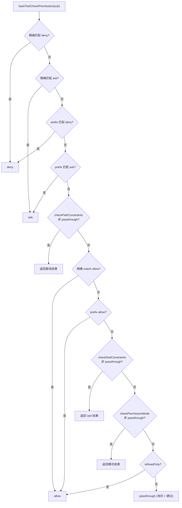
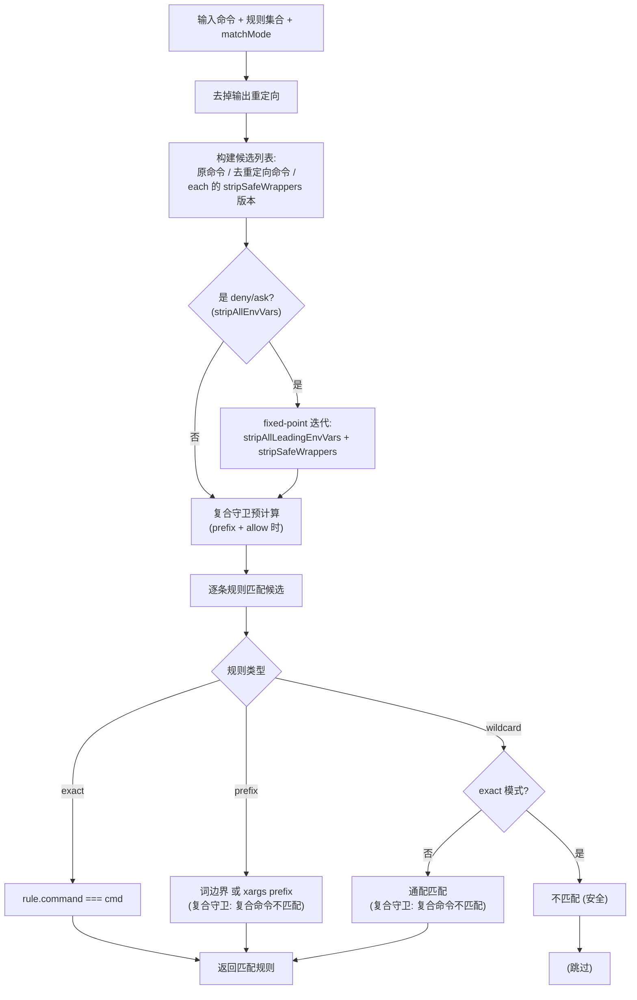

# Bash 工具权限处理深度解析（bashPermissions.ts）

> 基于源码逐行分析 `src/tools/BashTool/bashPermissions.ts`（约 2621 行），
> 梳理每个函数/常量的作用，解释 Bash 命令从发起、规则匹配、安全校验到最终放行/询问/拒绝的完整权限处理流程，并给出流程图。
> 本文是 [bash-tool.md](./bash-tool.md) 第 4 节的深入展开。

## 目录

1. [文件定位与设计思路](#1-文件定位与设计思路)
2. [常量与判定集](#2-常量与判定集)
3. [命令规范化与剥离工具函数](#3-命令规范化与剥离工具函数)
4. [权限规则匹配层](#4-权限规则匹配层)
5. [单子命令权限判定](#5-单子命令权限判定)
6. [沙箱自动放行](#6-沙箱自动放行)
7. [AST 路径的 deny 强制](#7-ast-路径的-deny-强制)
8. [分类器（BASH_CLASSIFIER）基础设施](#8-分类器bash_classifier基础设施)
9. [主入口 bashToolHasPermission 完整流程](#9-主入口-bashtoolhaspermission-完整流程)
10. [cd/git 归一化辅助](#10-cdgit-归一化辅助)
11. [权限处理流程图](#11-权限处理流程图)
12. [关键安全设计要点](#12-关键安全设计要点)
13. [同名工具函数速查表](#13-同名工具函数速查表)

---

## 1. 文件定位与设计思路

`bashPermissions.ts` 是 Bash 工具**权限检查的核心实现**，被 `BashTool.tsx` 的 `checkPermissions`（[BashTool.tsx:539](../src/tools/BashTool/BashTool.tsx#L539)）调用。它回答一个问题：

> **给定一条 Bash 命令，应当 `allow`（放行）、`ask`（询问用户）还是 `deny`（拒绝）？**

### 设计主线

- **规则优先**：显式的 allow/deny/ask 权限规则（来自 `.claude/settings.json` 等）拥有最高优先级，且 **deny > ask > allow**。
- **AST 先行**：用 tree-sitter 把命令解析成干净的子命令数组 `SimpleCommand[]`，取代旧的纯正则 `splitCommand`，用于判断 `splitCommand` 的输出能否信任。AST 解析结果有三种：`simple`（干净）、`too-complex`（结构复杂无法静态分析）、`parse-unavailable`（tree-sitter 未启用）。
- **分层防御**：规则匹配之外，还有路径约束（`checkPathConstraints`）、sed 约束、模式校验（`checkPermissionMode`）、只读校验、命令注入安全校验、cd+git 组合防护等多道防线。
- **分类器（BASH_CLASSIFIER）**：通过 GrowthBook feature gate 控制，把命令交给 Haiku 分类器做自然语言规则匹配（`Bash(allow: 描述)`），支持**推测式检查**（在用户响应前预计算、自动批准）。
- **Bun feature() DCE 约束**：文件顶部和多处函数都注释说明——`bashToolHasPermission` 逼近 Bun 的 `feature()` 求值复杂度预算，所以把大段逻辑拆成分离的小函数，且**避免在 import 块内用别名**（否则 `feature('BASH_CLASSIFIER')` 会被误判为非常数，静默把三目表达式求值为 `false`，丢失 `pendingClassifierCheck` 展开）。

---

## 2. 常量与判定集

| 常量 | 位置 | 作用 |
|------|------|------|
| `MAX_SUBCOMMANDS_FOR_SECURITY_CHECK` | [bashPermissions.ts:103](../src/tools/BashTool/bashPermissions.ts#L103) | 子命令数量上限（50）。CC-643：复杂的复合命令经 `splitCommand` 拆分可能指数级膨胀，超过上限则安全地 fallback 到 `ask`。 |
| `MAX_SUGGESTED_RULES_FOR_COMPOUND` | [bashPermissions.ts:110](../src/tools/BashTool/bashPermissions.ts#L110) | 复合命令最多建议保存的规则数（5）。GH#11380：一次保存 10+ 条规则更像噪音而非意图。 |
| `BARE_SHELL_PREFIXES` | [bashPermissions.ts:196](../src/tools/BashTool/bashPermissions.ts#L196) | **禁止**被推荐为 `Bash(x:*)` 前缀的 shell/包装命令集合：`sh/bash/zsh/.../cmd/powershell`、`env/xargs`、`nice/stdbuf/nohup/timeout/time`、`sudo/doas/pkexec`。原因是它们能通过 `-c` 执行任意代码（裸前缀 `bash:*` 等于放行一切）。 |
| `SAFE_ENV_VARS` | [bashPermissions.ts:378](../src/tools/BashTool/bashPermissions.ts#L378) | 允许从命令前缀剥离的**安全环境变量白名单**（如 `GOOS`、`RUST_LOG`、`NODE_ENV`、`TERM`、`LANG` 等）。注释明确：**绝不能**加 `PATH`、`LD_PRELOAD`、`LD_LIBRARY_PATH`、`DYLD_*`、`PYTHONPATH`、`NODE_OPTIONS`、`HOME`、`TMPDIR`、`SHELL`、`BASH_ENV` 等（会执行代码/加载库/影响系统行为）。 |
| `ANT_ONLY_SAFE_ENV_VARS` | [bashPermissions.ts:447](../src/tools/BashTool/bashPermissions.ts#L447) | **仅内部（ant）**生效的额外安全环境变量（`KUBECONFIG`、`DOCKER_HOST`、`AWS_PROFILE` 等）。注释强调这会隐藏网络端点、削弱前缀权限限制，**绝不外发**。 |
| `BINARY_HIJACK_VARS` | [bashPermissions.ts:708](../src/tools/BashTool/bashPermissions.ts#L708) | 能运行**不同二进制**的环境变量正则：`/^(LD_|DYLD_|PATH$)/`。用于 `sandbox.excludedCommands` 匹配时的 blocklist（非安全边界）。 |
| `TIMEOUT_FLAG_VALUE_RE` | [bashPermissions.ts:620](../src/tools/BashTool/bashPermissions.ts#L620) | `timeout` 标志值白名单 `/^[A-Za-z0-9_.+-]+$/`，拒绝 `$ ( ) \` \| ; &` 及换行——防止 `timeout -k$(id) 10 ls` 被错误剥离。 |

---

## 3. 命令规范化与剥离工具函数

这些函数把一条命令**规范化**到便于规则匹配的形式。核心思路：**先剥离无安全含义的前缀（环境变量、包装命令、注释），再匹配规则**，避免用户手动输入 `timeout 10 ls` 或 `GOOS=linux go build` 时匹配不上 `Bash(ls:*)`。

### 3.1 `stripCommentLines`（:508）
删除**整行**注释（整行以 `#` 开头或空行），保留行内注释（命令后的 `#` 不算）。若全是注释/空行则返回原串。

### 3.2 `stripSafeWrappers`（:524）—— 安全包装命令剥离
分两个阶段循环剥离，直到不动点：
- **Phase 1**：剥离**前置环境变量**（仅白名单内）和注释。匹配 `ENV_VAR_PATTERN = /^([A-Za-z_]\w*)=([A-Za-z0-9_./:-]+)[ \t]+/`。
- **Phase 2**：剥离**包装命令**（`timeout`/`time`/`nice`/`nohup`）。注释强调：`timeout VAR=val cmd` 中 `VAR=val` 会被当作要执行的**命令**而非环境变量，所以在包装命令之后**不再剥离环境变量**（HackerOne #3543050）。

**安全关键点**（代码注释反复强调）：
- 空白必须用 `[ \t]+`（水平空白）而非 `\s+`——`\s` 匹配 `\n`/`\r`，而换行在 bash 里是命令分隔符，跨行匹配会把一行剥离后留下另一行真正执行。
- `(?:--[ \t]+)?` 消费包装命令自身的 `--`，保证 `nohup -- rm -- -/../foo` 剥离成 `rm -- -/../foo` 而不是 `-- rm ...`（否则 `--` 会成为 path validation 的未知 baseCmd，跳过路径校验）。
- `timeout` 的 flag 值用白名单 `[A-Za-z0-9_.+-]`（信号 `TERM/KILL/9`、时长 `5/5s/10.5`）。
- `nice` 匹配 `nice cmd` / `nice -n N cmd` / `nice -N cmd`，与 `checkSemantics`（ast.ts）和 `stripWrappersFromArgv`（pathValidation.ts）**保持同步**（PR #21503 修复过不对称问题）。

### 3.3 `skipTimeoutFlags`（:633）与 `stripWrappersFromArgv`（:678）
`stripWrappersFromArgv` 是 `stripSafeWrappers` 的 **argv 级对等物**，作用于 AST 推导出的 argv 数组，且环境变量已在 `SimpleCommand.envVars` 中分离、无需再剥离。`skipTimeoutFlags` 从 argv 解析 `timeout` 的 GNU flags（长/短、`=`融合/空格分隔），返回**时长 token 的 argv 下标**；不可解析返回 `-1`（此时 `stripWrappersFromArgv` 直接返回原始 argv，fail-closed）。两者都消费可选的 `--`。被抽出成独立函数是为压到 Bun `feature()` 的复杂度预算线下（注释明确）。

### 3.4 `stripAllLeadingEnvVars`（:733）—— 激进剥离（deny/ask 用）
与 `stripSafeWrappers` 不同，它**剥离所有**前置环境变量（无论是否在安全白名单），值模式更宽（`FOO=a=b cmd` 也能匹配，防绕过），但仍排除 shell 注入字符（`$ \` ; | & ( ) 重定向 引号 反斜杠` 及空白），并支持 `FOO+=val`、`FOO[0]=val`、引号串、拼接段等复杂形式。可选 `blocklist`（传给 `BINARY_HIJACK_VARS` 用于 excludedCommands）。

**为什么 deny/ask 要激进、allow 要保守？**
- **allow**：`Bash(docker ps:*)` 不该被 `DOCKER_HOST=evil docker ps` 自动匹配——所以 only 剥安全变量（`DOCKER_HOST` 不在白名单，`docker ps` 无法匹配）。
- **deny/ask**：`FOO=bar denied_command` 必须**无法绕开** deny 规则——所以剥离所有前导环境变量。

### 3.5 前缀提取函数（生成"建议规则"用）

| 函数 | 位置 | 作用 |
|------|------|------|
| `getSimpleCommandPrefix` | [bashPermissions.ts:161](../src/tools/BashTool/bashPermissions.ts#L161) | 提取稳定前缀（命令+子命令，如 `git commit`）。跳过白名单环境变量；遇非安全环境变量、第二 token 不像子命令（flag/文件名/数字）时返回 `null`（回退到精确匹配）。**避免生成永远匹配不上的规则**。 |
| `getFirstWordPrefix` | [bashPermissions.ts:243](../src/tools/BashTool/bashPermissions.ts#L243) | UI-only 回退：当 `getSimpleCommandPrefix` 拒绝时只取首个单词作为**可编辑起点**（外部构建 TREE_SITTER_BASH 关闭时，`BashPermissionRequest` 的异步 tree-sitter 细化不触发，管道/复合命令会整段倾倒进编辑框）。复用 `SAFE_ENV_VARS` 门 + `BARE_SHELL_PREFIXES` 拒绝。**刻意不被 `suggestionForExactCommand` 使用**——后端建议 `Bash(rm:*)` 太宽。 |
| `extractPrefixBeforeHeredoc` | [bashPermissions.ts:307](../src/tools/BashTool/bashPermissions.ts#L307) | 若命令含 heredoc（`<<`），提取操作符前的稳定前缀。heredoc 内容每次调用都变，精确匹配规则永远匹配不上，故建议前缀规则。 |
| `suggestionForExactCommand` | [bashPermissions.ts:266](../src/tools/BashTool/bashPermissions.ts#L266) | 为命令生成建议的权限更新：heredoc→前缀规则；含换行→首行前缀；单行→2 词前缀；否则精确匹配。 |
| `suggestionForPrefix` | [bashPermissions.ts:339](../src/tools/BashTool/bashPermissions.ts#L339) | 生成 `Bash(prefix:*)` 前缀规则建议。 |
| `permissionRuleExtractPrefix` / `matchWildcardPattern` / `bashPermissionRule` | :347 / :353 / :364 | 三个**委托**到 `utils/permissions/shellRuleMatching.ts` 的共享实现（前缀提取、通配匹配、规则解析）。 |

**`stripSafeWrappers` 与 `stripAllLeadingEnvVars` 的差别小结**：

| 维度 | `stripSafeWrappers` | `stripAllLeadingEnvVars` |
|------|--------------------|--------------------------|
| 环境变量 | 仅剥白名单（`SAFE_ENV_VARS` / ant 额外） | 剥**所有**前导环境变量 |
| 包装命令 | 剥 timeout/time/nice/nohup | 不剥（由外层循环配合） |
| 值模式 | 保守 `[A-Za-z0-9_./:-]+` | 宽（含 `=` `+` `@` 等）防绕过 |
| 用途 | allow 规则匹配 | deny/ask 规则匹配、excludedCommands 匹配 |

---

## 4. 权限规则匹配层

### 4.1 `filterRulesByContentsMatchingInput`（:778）
把规则集合（按内容建的 `Map<string, PermissionRule>`）过滤出匹配当前输入的那些。核心逻辑：

1. 先 `extractOutputRedirections` 去掉输出重定向（`python script.py > out` 仍匹配 `Bash(python:*)`；重定向目标的安全校验由 `checkPathConstraints` 单独做）。
2. 构建候选命令列表：
   - **exact 模式**：尝试原命令 + 去掉重定向的命令（保引号）。
   - **prefix 模式**：只尝试去掉重定向的命令。
   - 每个命令同时尝试剥离包装命令后的版本（`[cmd, stripped]`）。
3. **deny/ask 时**（`stripAllEnvVars: true`）：迭代对候选应用 `stripAllLeadingEnvVars` 和 `stripSafeWrappers`，直到不动点（fixed-point），处理 `nohup FOO=bar timeout 5 claude` 这类多层交错。
4. **复合命令守卫**（`prefix` 模式 + allow 规则，未 `skipCompoundCheck`）：预计算每个候选的 `splitCommand(cmd).length > 1`。**prefix/wildcard 规则不得匹配复合命令**——否则 `Bash(cd:*)` 会匹配 `cd /path && python3 evil.py`；再次拆分能抓住 `cd src\&\& python3 hello.py` 之类转义绕过。
5. 匹配逻辑按规则类型分派：
   - **exact**：`rule.command === cmdToMatch`。
   - **prefix**：exact 模式要求完全相等；prefix 模式要求复合守卫通过 + 词边界（`cmd === prefix || cmd.startsWith(prefix + ' ')`），还支持 `xargs <prefix>` 形式（`Bash(rm:*)` 拦 `xargs rm file`）。
   - **wildcard**：**exact 模式下通配一律不匹配**（`foo *` 能匹配 `foo arg && curl evil.com`）；仅 prefix 模式（拆分后）可匹配，且受复合守卫约束。

### 4.2 `matchingRulesForInput`（:937）
按工具上下文分别取出 deny / ask / allow 规则并过滤：
- deny、ask：`stripAllEnvVars: true`、`skipCompoundCheck: true`——**deny/ask 必须匹配复合命令**（不可被包裹绕过）。
- allow：默认（`skipCompoundCheck` 由调用方决定——只有非 AST 路径需要复合守卫）。
- 返回 `{ matchingDenyRules, matchingAskRules, matchingAllowRules }` 三个数组。

---

## 5. 单子命令权限判定

文件提供两层"单命令"判定入口，供主子命令循环与复合命令处理复用。

### 5.1 `bashToolCheckExactMatchPermission`（:991）
只做**精确匹配**判断，顺序固定：
1. 命中 deny 规则 → `deny`。
2. 命中 ask 规则 → `ask`。
3. 命中 allow 规则 → `allow`。
4. 否则 → `passthrough`（附精确匹配规则建议，可被 `checkCommandAndSuggestRules` 用前缀建议覆盖）。

> 注意：这里 deny/ask/allow 用的是各自独立的匹配，且**精确匹配规则建议**在 passthrough 时附带。

### 5.2 `bashToolCheckPermission`（:1050）
单个子命令的完整判定（**不含**分类器和注入安全检查），顺序：
1. **先精确匹配**：deny/ask 直接返回。
2. **再 prefix 匹配**（`matchingRulesForInput(..., 'prefix')`），deny/ask 直接返回。注释强调 deny/ask 在路径约束**之前**——防 `ls /home`（路径受限返回 ask）绕过 `Bash(ls:*)` deny（HackerOne）。
3. **路径约束** `checkPathConstraints`：非 passthrough 直接返回。有 AST argv 时直接传入（避免 shell-quote 单引号反斜杠 bug 导致返空、静默跳过路径校验）。
4. **精确 allow** 直接返回。
5. **prefix allow** 返回。
6. **sed 约束** `checkSedConstraints`：拦截危险 sed（在模式自动放行之前）。
7. **模式校验** `checkPermissionMode`：plan/auto 等模式的特殊处理。
8. **只读** `BashTool.isReadOnly(input)` → `allow`。
9. 否则 `passthrough`（附精确匹配建议）。

**判定的优先级（从高到低）**：deny 规则 → ask 规则 → 路径约束 → allow 规则 → sed 约束 → 模式 → 只读 → passthrough（询问）。

### 5.3 `checkCommandAndSuggestRules`（:1183）
异步版本的子命令处理，额外做：
1. 先精确匹配，非 passthrough 直接返回。
2. 调 `bashToolCheckPermission`；deny/ask 直接返回。
3. **命令注入检查**：AST 未成功时（`!astParseSucceeded`）且未禁注入检查，则 `bashCommandIsSafeAsync`；不安全 → `ask`（**不附带规则建议**，防止保存危险命令）。
4. allow 直接返回。
5. 否则生成建议：有 `commandPrefixResult?.commandPrefix` 用前缀建议，否则精确匹配建议。

---

## 6. 沙箱自动放行

### 6.1 `checkSandboxAutoAllow`（:1270）
当沙箱 + 自动放行（`autoAllowBashIfSandboxed`）开启时调用。逻辑：
1. 对**完整命令**做 prefix 匹配，命中 deny → `deny`。
2. **复合命令**拆子命令逐个查 deny/ask：**任何子命令命中 deny 立即返回 `deny`**（deny 优先于整命令的 ask）；否则记录首个 ask。注释强调**子命令 deny 必须在整命令 ask 之前**——否则 `Bash(*echo*)` 通配 ask 会把子命令的 `Bash(rm:*)` deny 降级成 ask。
3. 整命令 ask 命中 → `ask`。
4. 无显式规则 → `allow`（自动放行，理由标注 sandbox）。

**只在沙箱化且自动放行开启时调用**，正常流程在 `bashToolHasPermission` 的 AST 之后、精确匹配之前（见第 9 节）。

---

## 7. AST 路径的 deny 强制

这三个函数是为了在 AST `too-complex`/语义失败路径上**优先执行 deny 规则**，绝不把 deny 降级为 ask。它们被拆成独立函数以压低 `bashToolHasPermission` 的 `feature()` 复杂度。

| 函数 | 位置 | 作用 |
|------|------|------|
| `filterCdCwdSubcommands` | [bashPermissions.ts:1367](../src/tools/BashTool/bashPermissions.ts#L1367) | 过滤掉 `cd ${cwd}` / `cd ${cwdMingw}` 前缀子命令（模型爱加），保持 `astCommands` 按索引对齐。 |
| `checkEarlyExitDeny` | [bashPermissions.ts:1391](../src/tools/BashTool/bashPermissions.ts#L1391) | too-complex/semantics 路径的早退 deny：先精确匹配（deny/ask/allow 非 passthrough 即返回），再查 prefix/wildcard deny。都无 → 返回 `null`（调用方 fall through 到 ask）。 |
| `checkSemanticsDeny` | [bashPermissions.ts:1431](../src/tools/BashTool/bashPermissions.ts#L1431) | checkSemantics 路径的 deny：先 `checkEarlyExitDeny`（整命令精确 + 前缀 deny），再对每个 `SimpleCommand.text` span 查前缀 deny。**需要 per-command 检查**，因为 `filterRulesByContentsMatchingInput` 的复合守卫（`splitCommand().length > 1`）会挡 `Bash(eval:*)` 匹配 `echo foo \| eval rm`；而单个 span 是单命令、守卫不触发。 |

---

## 8. 分类器（BASH_CLASSIFIER）基础设施

分类器把命令交给 Haiku，按用户在权限提示里写的自然语言 `Bash(allow: ...)` / deny / ask 描述做**高置信匹配**，实现自动批准/自动拒绝。`speculativeChecks` 是一个 Module 级 `Map<string, Promise<ClassifierResult>>`，用于**推测式预计算**（在 pre-tool hooks、deny/ask 分类器、权限对话框设置期间并行跑，等用户响应时结果已就绪）。

| 函数 | 位置 | 作用 |
|------|------|------|
| `buildPendingClassifierCheck` | [bashPermissions.ts:1459](../src/tools/BashTool/bashPermissions.ts#L1459) | 构造 `{ command, cwd, descriptions }` 元数据。返回 `undefined` 当：分类器未启用、auto 模式（`TRANSCRIPT_CLASSIFIER` feature）、`bypassPermissions`、或无 allow 描述。 |
| `peekSpeculativeClassifierCheck` | [bashPermissions.ts:1491](../src/tools/BashTool/bashPermissions.ts#L1491) | 查看某命令的推测结果（不消费）。 |
| `startSpeculativeClassifierCheck` | [bashPermissions.ts:1497](../src/tools/BashTool/bashPermissions.ts#L1497) | 提前启动分类器（与 `buildPendingClassifierCheck` 相同的守卫）。丢弃下流化 `.catch(() => {})` 防未处理拒绝，原 promise 仍存 Map 供消费。返回是否启动成功。 |
| `consumeSpeculativeClassifierCheck` | [bashPermissions.ts:1533](../src/tools/BashTool/bashPermissions.ts#L1533) | 取出并删除某命令的推测 promise。 |
| `clearSpeculativeChecks` | [bashPermissions.ts:1543](../src/tools/BashTool/bashPermissions.ts#L1543) | 清空全部推测检查。 |
| `awaitClassifierAutoApproval` | [bashPermissions.ts:1555](../src/tools/BashTool/bashPermissions.ts#L1555) | 被 **swarm 代理**（tmux 与 in-process）用于权限转发：先跑分类器，仅在未自动批准时才升级给 leader。返回高置信匹配则给出 `classifier` 决策理由，否则 `undefined`。 |
| `executeAsyncClassifierCheck` | [bashPermissions.ts:1605](../src/tools/BashTool/bashPermissions.ts#L1605) | **权限对话框后台执行**的入口。消费推测结果，处理 abort（`APIUserAbortError`/`AbortError` 走 `onComplete` 正常结束），`shouldContinue()` 为假（用户已交互）则不覆盖。高置信匹配 → `onAllow`，否则 `onComplete` 清掉"检查中"指示。 |
| `logClassifierResultForAnts` | [bashPermissions.ts:117](../src/tools/BashTool/bashPermissions.ts#L117) | 仅 `USER_TYPE === 'ant'` 时上报分类器评估日志（`tengu_internal_bash_classifier_result`）供分析。 |

---

## 9. 主入口 bashToolHasPermission 完整流程

`bashToolHasPermission`（[bashPermissions.ts:1663](../src/tools/BashTool/bashPermissions.ts#L1663)）是**总入口**，返回 `PermissionResult`。按执行顺序：

### 阶段 0：AST 安全解析
- `CLAUDE_CODE_DISABLE_COMMAND_INJECTION_CHECK` 为真或 tree-sitter 被 feature killswitch 关掉 → `astResult = { kind: 'parse-unavailable' }`。
- 否则 `parseCommandRaw(input.command)` → `parseForSecurityFromAst`，得 `astSubcommands`（`SimpleCommand[].text`）、`astRedirects`、`astCommands`。
- **shadow 模式**（`TREE_SITTER_BASH_SHADOW` feature）：记录 tree-sitter 与 legacy 的判定分歧日志（`available/tooComplex/semanticFail/subsDiffer`），然后**强制** `astResult = parse-unavailable`、`astRoot = null`，让 legacy 路径保持权威（观察为主）。

### 阶段 1：按解析结果分派
- **`too-complex`**：`checkEarlyExitDeny` 早退（deny 优先）；无 deny 则 `ask`（理由 `astResult.reason`），附带 pending 分类器检查。
- **`simple`**：`checkSemantics` 检查危险命令名（zsh 内建、eval 等）。失败 → `checkSemanticsDeny` 早退，否则 `ask`；成功 → 缓存 `astSubcommands/astRedirects/astCommands`。
- **`parse-unavailable`**：走 legacy `tryParseShellCommand`，语法解析失败直接 `ask`（`malformed syntax`）。

### 阶段 2：沙箱自动放行
若沙箱 + 自动放行 + `shouldUseSandbox(input)` → `checkSandboxAutoAllow`，非 passthrough 即返回。

### 阶段 3：精确匹配
`bashToolCheckExactMatchPermission`；`deny` 直接返回。

### 阶段 4：deny/ask 分类器（Haiku）
非 auto 模式且分类器启用时，并行跑 deny 与 ask 分类器：
- abort → 抛 `AbortError`。
- deny 高置信匹配 → `deny`。
- ask 高置信匹配 → `ask`（附建议；当 `getCommandSubcommandPrefixFn` 是默认函数时**跳过 Haiku 前缀调用**，UI 本地算前缀可编辑），附带 pending 分类器检查。

### 阶段 5：命令操作符（管道/重定向）
`checkCommandOperatorPermissions`（bashCommandHelpers.ts）处理非子命令操作符（`>`、`|` 等）：
- **allow**（管道段全放行）：仍需校验**原始命令**——对重定向目标跑 `checkPathConstraints`（`compoundCommandHasCd = commandHasAnyCd(input.command)`，不可硬编码 false，防 `cd .claude && echo x > settings.json` 被 `| echo done` 绕过），AST 未成功时再跑 `bashCommandIsSafeAsync` 捕后置反引号等。附带 pending 分类器检查。
- **ask**：附带 pending 分类器检查。
- 否则原样返回。

### 阶段 6：legacy 误解析 gate
仅当 `astSubcommands === null`（AST 未加载）且未禁注入检查：`bashCommandIsSafeAsync(input.command)`，若为 `ask` 且 `isBashSecurityCheckForMisparsing`，再剥安全 heredoc 复检 remainder；仍不安全 → 精确 allow 则放行，否则 `ask`（附 pending 分类器）。

### 阶段 7：拆分与前置守卫
- 子命令来源：`astSubcommands ?? shadowLegacySubs ?? splitCommand(...)`，经 `filterCdCwdSubcommands` 去掉 `cd ${cwd}`。
- legacy 路径子命令数超 `MAX_SUBCOMMANDS_FOR_SECURITY_CHECK`（50）→ `ask`。
- **多个 `cd`** → `ask`（多目录变更需澄清）。
- `compoundCommandHasCd` 为真且含 **git 命令** → `ask`（防 `cd /malicious/dir && git status` 裸仓库 `core.fsmonitor` 沙箱逃逸）。此检查必须在子命令级权限检查**之前**（否则 `BashTool.isReadOnly("git status")` 会重算出 `compoundCommandHasCd=false`）。

### 阶段 8：子命令级权限
`appState` 重算（用户可能 shift+tab 切换）后，对每个子命令跑 `bashToolCheckPermission({command}, ...)`：
- 任一子命令 `deny` → 整体 `deny`（`decisionReason.type = 'subcommandResults'` 携带各子命令映射）。
- 再对**原始命令**（splitCommand 已剥掉重定向）跑 `checkPathConstraints`，`deny` 直接返回。
- pathResult 为 `ask` 且无子命令 ask（GH#28784 修复：避免只在路径上建议 Read 规则而静默批准 python3）→ 返回 pathResult。
- 恰有一个子命令 ask（`nonAllowCount === 1`）→ 返回该 ask（附 pending 分类器）。
- 精确 allow → 返回。

### 阶段 9：注入检查 + 全放行判定
- legacy 路径下对每个子命令并行 `bashCommandIsSafeAsync`（聚合分歧计数日志 `tengu_tree_sitter_security_divergence`）。
- 所有子命令 allow 且无注入 → 整体 `allow`。

### 阶段 10：前缀查询 + 子命令建议
- 非默认 `getCommandSubcommandPrefixFn`（测试注入）时才调用 Haiku 前缀查询。
- 单子命令 → `checkCommandAndSuggestRules`；ask/passthrough 附 pending 分类器。
- 多子命令 → 逐个 `checkCommandAndSuggestRules`，收集所有 ask/passthrough 子命令的规则建议（去重、压缩到 `MAX_SUGGESTED_RULES_FOR_COMPOUND`；无建议且非显式 ask 规则时合成精确匹配规则，让 UI 显示连锁命令如 `cd ~/out && rm -rf x`）。
- 全子命令 allow → 整体 `allow`。
- 否则 → `ask`（若有子命令 ask）或 `passthrough`，附建议更新 + pending 分类器。

---

## 10. cd/git 归一化辅助

| 函数 | 位置 | 作用 |
|------|------|------|
| `isNormalizedGitCommand` | [bashPermissions.ts:2567](../src/tools/BashTool/bashPermissions.ts#L2567) | 归一化（剥安全包装、shell 引号）后判断是否 git 命令。`xargs git ...` 也算（xargs 在当前目录跑 git，防 cd+git 逃逸）。 |
| `isNormalizedCdCommand` | [bashPermissions.ts:2603](../src/tools/BashTool/bashPermissions.ts#L2603) | 归一化后判断是否 `cd`/`pushd`/`popd`（都改 cwd，故都触发 cd+git 守卫；与 PowerShell 的 `DIRECTORY_CHANGE_ALIASES` 对应）。 |
| `commandHasAnyCd` | [bashPermissions.ts:2617](../src/tools/BashTool/bashPermissions.ts#L2617) | 拆分后任一子命令含 cd（归一化判定），用于管道路径计算 `compoundCommandHasCd`。 |

---

## 11. 权限处理流程图

### 11.1 总流程（bashToolHasPermission）

```mermaid
flowchart TD
    START(["bashToolHasPermission(input)"]) --> AST["阶段0: AST 安全解析<br/>parseCommandRaw / parseForSecurityFromAst<br/>shadow 模式: 记录分歧后强制走 legacy"]
    AST --> K{f"解析结果"}
    K -->|"too-complex"| TC["checkEarlyExitDeny<br/>精确 + prefix/wildcard deny"]
    TC -->|"有 deny"| DENYT["deny"]
    TC -->|"无 deny"| TCASK["ask (附带 pendingClassifierCheck)"]
    K -->|"simple"| SEM["checkSemantics 危险名检查"]
    SEM -->|"失败"| SEMD["checkSemanticsDeny (per-span deny)"]
    SEMD -->|"有 deny"| DENYT
    SEMD -->|"无 deny"| SEMASK["ask"]
    SEM -->|"成功"| USESUB["缓存 astSubcommands / astRedirects / astCommands"]
    K -->|"parse-unavailable"| LEG["legacy tryParseShellCommand"]
    LEG -->|"语法错误"| SYNASK["ask: malformed syntax"]

    USESUB --> SBOX{"沙箱 + 自动放行?"}
    LEG --> SBOX
    SBOX -->|"是"| SBOXA["checkSandboxAutoAllow<br/>(子命令 deny 优先于整命令 ask)"]
    SBOXA -->|"非 passthrough"| SBOXR["返回 deny/ask/allow"] --> RET
    SBOX -->|"否"| EXACT["阶段3: 精确匹配<br/>bashToolCheckExactMatchPermission"]
    SBOXA -->|"passthrough"| EXACT
    EXACT -->|"deny"| DENYT
    EXACT -->|"ask/allow/passthrough"| CLS{"分类器启用 且 非 auto?"}

    CLS -->|"是"| CLSr["并行 deny/ask 分类器"]
    CLSr -->|"deny 高置信"| DENYT
    CLSr -->|"ask 高置信"| CLSASK["ask (建议 + pendingClassifierCheck)"]
    CLSr -->|"都不匹配"| OPR
    CLS -->|"否"| OPR

    OPR["阶段5: checkCommandOperatorPermissions<br/>(管道 / 重定向操作符)"]
    OPR -->|"allow"| OPRALLOW["校验原始命令:<br/>checkPathConstraints + 注入复检"]
    OPRALLOW -->|"非 passthrough"| PV["返回路径/安全结果"]
    OPR -->|"ask"| OPRASK["ask + pendingClassifierCheck"]
    OPR -->|"其他"| OPRRET["返回操作符结果"]
    OPRALLOW -->|"passthrough"| GATE

    GATE["阶段6: legacy 误解析 gate<br/>bashCommandIsSafeAsync + 剥 heredoc 复检"] --> SPLIT
    SPLIT["阶段7: 拆分子命令<br/>filterCdCwdSubcommands 去 cd cwd"]
    SPLIT -->|">50 子命令"| CAPASK["ask: 太多子命令"]
    SPLIT -->|"多个 cd"| CDASK["ask: 多目录变更"]
    SPLIT -->|"cd + git"| GITASK["ask: 裸仓库攻击防护"]
    SPLIT --> SUB["阶段8: 逐子命令 bashToolCheckPermission"]
    SUB -->|"任一 deny"| DENYT
    SUB -->|"路径 deny"| PV
    SUB -->|"1 个 ask"| SUBASK["ask + pendingClassifierCheck"]
    SUB -->|"全 allow"| INJ["阶段9: 注入检查 + 全放行?"]
    INJ -->|"全 allow 且无注入"| ALLOW["allow"]
    INJ -->|"否"| SUGGEST["阶段10: checkCommandAndSuggestRules<br/>收集建议规则 (封顶5)"]
    SUGGEST -->|"全 allow"| ALLOW
    SUGGEST -->|"有 ask"| FINALASK["ask + 建议 + pendingClassifierCheck"]
    SUGGEST -->|"其余"| FINALPT["passthrough + 建议"]

    DENYT --> RET
    TCASK --> RET
    SEMASK --> RET
    CLSASK --> RET
    CAPASK --> RET
    CDASK --> RET
    GITASK --> RET
    PV --> RET
    SUBASK --> RET
    OPRASK --> RET
    OPRRET --> RET
    ALLOW --> RET
    FINALASK --> RET
    FINALPT --> RET
    RET(["✔ 返回 PermissionResult"])
```

### 11.2 单子命令判定（bashToolCheckPermission）



### 11.3 规则匹配细化（filterRulesByContentsMatchingInput）



---

## 12. 关键安全设计要点

1. **deny > ask > allow**，且 deny 在路径约束/模式自动放行**之前**求值，避免路径受限返回 ask 反而绕过 deny（HackerOne）。
2. **allow 保守剥离、deny 激进剥离**：allow 只剥白名单环境变量（防 `DOCKER_HOST=evil docker ps` 匹配 `Bash(docker ps:*)`）；deny/ask 剥所有前导环境变量（防 `FOO=bar denied_cmd` 绕过）。
3. **复合命令守卫**：prefix/wildcard 规则默认不匹配复合命令（`cd x && evil` / 转义 `&&`），但 deny/ask 例外（必须匹配、不可被包裹绕过）。
4. **精确模式通配不匹配**：防 `foo *` 匹配 `foo arg && curl evil.com`。
5. **空白用 `[ \t]+` 不用 `\s+`**：`\s` 会跨换行剥离而 bash 把换行当命令分隔符，可能泄露真正执行的命令。
6. **AST 优先**：tree-sitter 成功时跳过 legacy 正则注入检查（避免误报），同时保证 `splitCommand` 输出可信。
7. **AST 不可分析（too-complex）fail-closed**：无法证明安全 → deny 优先，否则问用户。
8. **cd+git / 多个 cd / cd+重定向** 组合防护：防裸仓库 `core.fsmonitor` 逃逸、防 `cd .claude && 重定向` 写入敏感文件。
9. **子命令数量/建议规则封顶**：防 ReDoS 冻结事件循环（CC-643）、防规则噪音（GH#11380）。
10. **推测式分类器**：与 hooks/permission 对话框并行预计算，高置信自动批准，用户已交互则不覆盖。
11. **`BARE_SHELL_PREFIXES`** 阻止 `bash:*`/`sudo:*`/`env:*` 等宽得危险的建议——否则用户批准后等于放行任意代码。

---

## 13. 同名工具函数速查表

| 函数 | 位置 | 一句话作用 |
|------|------|-----------|
| `bashToolHasPermission` | [:1663](../src/tools/BashTool/bashPermissions.ts#L1663) | **总入口**：Bash 权限处理的完整流水线。 |
| `bashToolCheckExactMatchPermission` | [:991](../src/tools/BashTool/bashPermissions.ts#L991) | 仅精确匹配：deny/ask/allow/passthrough。 |
| `bashToolCheckPermission` | [:1050](../src/tools/BashTool/bashPermissions.ts#L1050) | 单子命令完整判定（规则+路径+sed+模式+只读）。 |
| `checkCommandAndSuggestRules` | [:1183](../src/tools/BashTool/bashPermissions.ts#L1183) | 子命令处理 + 注入检查 + 建议生成。 |
| `matchingRulesForInput` | [:937](../src/tools/BashTool/bashPermissions.ts#L937) | 取 deny/ask/allow 三类匹配规则。 |
| `filterRulesByContentsMatchingInput` | [:778](../src/tools/BashTool/bashPermissions.ts#L778) | 规则×候选命令匹配（含剥离与复合守卫）。 |
| `checkSandboxAutoAllow` | [:1270](../src/tools/BashTool/bashPermissions.ts#L1270) | 沙箱自动放行判定（尊重显式 deny/ask）。 |
| `checkEarlyExitDeny` | [:1391](../src/tools/BashTool/bashPermissions.ts#L1391) | too-complex/语义路径的早退 deny。 |
| `checkSemanticsDeny` | [:1431](../src/tools/BashTool/bashPermissions.ts#L1431) | 语义失败路径的 per-span deny 强制。 |
| `buildPendingClassifierCheck` | [:1459](../src/tools/BashTool/bashPermissions.ts#L1459) | 构造分类器检查元数据。 |
| `startSpeculativeClassifierCheck` | [:1497](../src/tools/BashTool/bashPermissions.ts#L1497) | 提前启动推测分类器。 |
| `consumeSpeculativeClassifierCheck` | [:1533](../src/tools/BashTool/bashPermissions.ts#L1533) | 消费（并移除）推测结果。 |
| `executeAsyncClassifierCheck` | [:1605](../src/tools/BashTool/bashPermissions.ts#L1605) | 对话框后台分类器执行（可自动批准）。 |
| `awaitClassifierAutoApproval` | [:1555](../src/tools/BashTool/bashPermissions.ts#L1555) | swarm 代理的分类器自动批准判定。 |
| `stripSafeWrappers` | [:524](../src/tools/BashTool/bashPermissions.ts#L524) | 剥安全包装 + 白名单环境变量。 |
| `stripAllLeadingEnvVars` | [:733](../src/tools/BashTool/bashPermissions.ts#L733) | 剥所有前导环境变量（deny/ask 用）。 |
| `stripWrappersFromArgv` | [:678](../src/tools/BashTool/bashPermissions.ts#L678) | argv 级剥包装命令。 |
| `getSimpleCommandPrefix` | [:161](../src/tools/BashTool/bashPermissions.ts#L161) | 提取 2 词稳定前缀。 |
| `suggestionForExactCommand` / `suggestionForPrefix` | :266 / :339 | 生成精确/前缀规则建议。 |
| `isNormalizedGitCommand` / `isNormalizedCdCommand` | :2567 / :2603 | 归一化判定 git / cd(pushd,popd)。 |
| `commandHasAnyCd` | [:2617](../src/tools/BashTool/bashPermissions.ts#L2617) | 拆分后是否含 cd。 |
