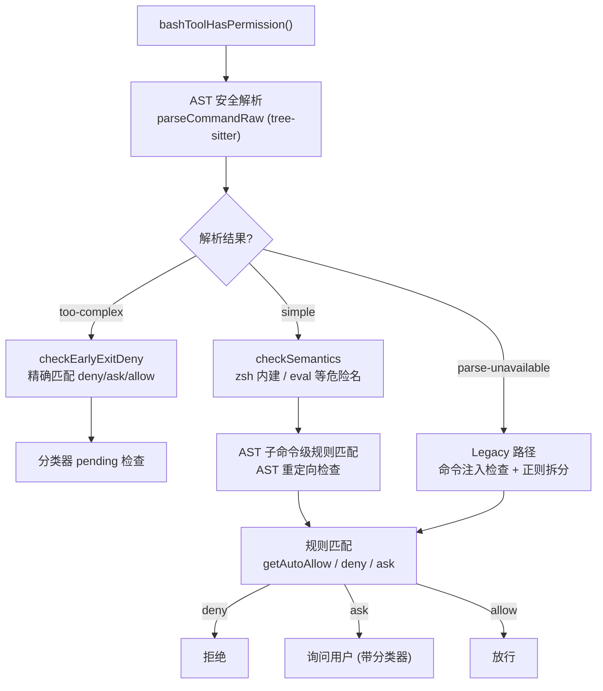
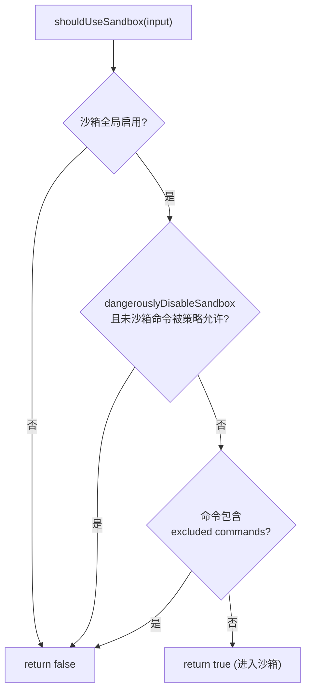
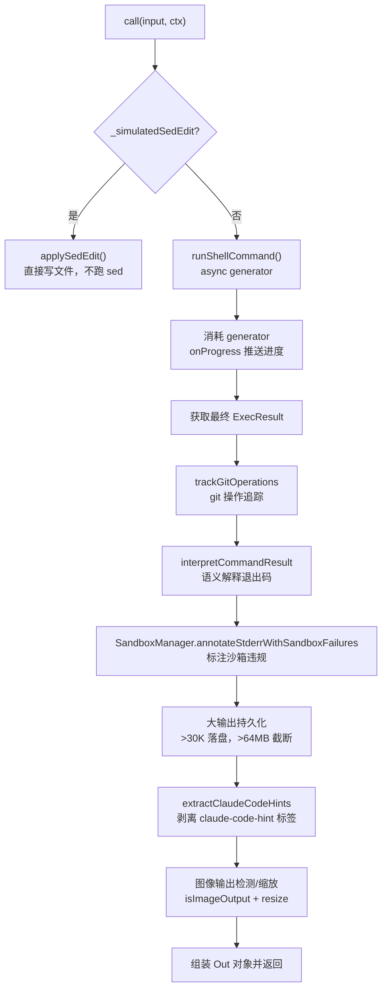
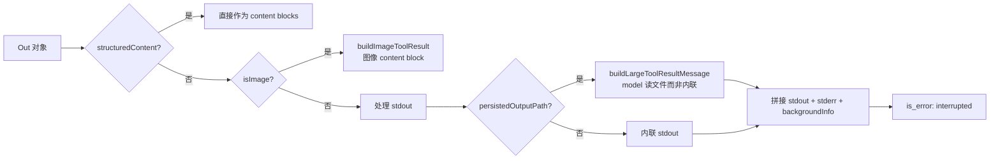

# Claude Code Bash 工具深度拆解

> 基于源码分析，从 Schema 定义、权限检查、sandbox、命令执行、后台任务到结果映射的完整链路。
> 核心文件：`src/tools/BashTool/`

## 目录

1. [架构总览](#1-架构总览)
2. [输入 Schema 定义](#2-输入-schema-定义)
3. [模型提示词（prompt）](#3-模型提示词prompt)
4. [权限检查（checkPermissions）](#4-权限检查checkpermissions)
5. [沙箱判定（shouldUseSandbox）](#5-沙箱判定shouldusesandbox)
6. [命令执行（call）](#6-命令执行call)
7. [后台任务机制](#7-后台任务机制)
8. [结果映射（mapToolResult）](#8-结果映射maptoolresult)
9. [UI 展示与活动描述](#9-ui-展示与活动描述)
10. [关键源码速查](#10-关键源码速查)

---

## 1. 架构总览

Bash 工具是 Claude Code 的**内置工具**，通过 `buildTool()`（`src/Tool.ts`）构造，其定义横跨多个文件，形成一条完整链路：

```
Schema 定义 (BashTool.tsx)
  → 权限检查 (bashPermissions.ts / readOnlyValidation.ts)
  → 沙箱判定 (shouldUseSandbox.ts)
  → 命令执行 (call → runShellCommand → exec)
  → 结果映射 (mapToolResultToToolResultBlockParam)
  → UI 展示 (UI.tsx)
```

**关键文件分布**：

| 文件 | 职责 | 行数 |
|------|------|------|
| `BashTool.tsx` | 工具定义、input/output Schema、`call` 执行主体 | 1143 |
| `bashPermissions.ts` | 权限检查（AST 解析 + 规则匹配 + 分类器） | 2621 |
| `readOnlyValidation.ts` | 只读约束校验（判断是否只读命令） | 1990 |
| `shouldUseSandbox.ts` | 判定命令是否需要在沙箱中运行 | 153 |
| `commandSemantics.ts` | 命令结果语义解释（非 0 退出码含义） | 140 |
| `prompt.ts` | 模型面向的提示词（`getSimplePrompt`） | 369 |
| `toolName.ts` | 工具名常量（`BASH_TOOL_NAME = 'Bash'`） | 2 |
| `UI.tsx` | 工具 UI 渲染组件 | 184 |

### 工具对象定义要点

`buildTool` 声明了几个对 Bash 至关重要的配置（`BashTool.tsx:420-480`）：

- `name: BASH_TOOL_NAME`（即 `'Bash'`）
- `searchHint: 'execute shell commands'`
- `maxResultSizeChars: 30_000`（工具结果持久化阈值，超长落盘）
- `strict: true`
- `description()`：返回用户提供的 desc 或 `'Run shell command'`
- `prompt()`：返回 `getSimplePrompt()` 的完整提示词
- `isReadOnly` / `isConcurrencySafe`：只读命令可并发安全执行
- `isSearchOrReadCommand`：用于 UI 决定是否折叠展示

---

## 2. 输入 Schema 定义

输入 Schema 定义于 [`BashTool.tsx:227-247`](../src/tools/BashTool/BashTool.tsx#L227)，用 zod `z.strictObject` 声明，外包 `lazySchema()` 延迟求值以打破 import 循环：

```typescript
const fullInputSchema = lazySchema(() => z.strictObject({
  command: z.string().describe('The command to execute'),
  timeout: semanticNumber(z.number().optional()).describe(`Optional timeout in milliseconds (max ${getMaxTimeoutMs()})`),
  description: z.string().optional().describe(`Clear, concise description of what this command does in active voice. ...`),
  run_in_background: semanticBoolean(z.boolean().optional()).describe(`Set to true to run this command in the background. ...`),
  dangerouslyDisableSandbox: semanticBoolean(z.boolean().optional()).describe('Set this to true to dangerously override sandbox mode...'),
  _simulatedSedEdit: z.object({ filePath: z.string(), newContent: z.string() })
    .optional().describe('Internal: pre-computed sed edit result from preview')
}));
```

### 各字段语义

| 字段 | 类型 | 用途 |
|------|------|------|
| `command` | string（必填） | 要执行的 Shell 命令 |
| `timeout` | number? | 超时（毫秒），上限 `getMaxTimeoutMs()` |
| `description` | string? | **活动描述（UI 展示）**，由模型生成，不参与执行 |
| `run_in_background` | boolean? | 后台异步执行，完成后通知 |
| `dangerouslyDisableSandbox` | boolean? | 禁用沙箱（需权限 + 策略允许） |
| `_simulatedSedEdit` | object? | **内部字段**：sed 编辑预览的预计算结果 |

### `_simulatedSedEdit` 的隐藏

[`BashTool.tsx:249-259`](../src/tools/BashTool/BashTool.tsx#L249) 处，`inputSchema` 用 `.omit({ _simulatedSedEdit: true })` **隐藏了内部字段**——模型永远看不到它。原因是安全：`sedEditPermissionRequest` 在用户批准预览后设置该字段，暴露它会让模型用"无害命令 + 任意文件写入"绕过权限检查和沙箱。

```typescript
const inputSchema = lazySchema(() =>
  isBackgroundTasksDisabled
    ? fullInputSchema().omit({ run_in_background: true, _simulatedSedEdit: true })
    : fullInputSchema().omit({ _simulatedSedEdit: true })
);
```

当 `CLAUDE_CODE_DISABLE_BACKGROUND_TASKS` 环境变量设置时，`run_in_background` 也被一并隐藏。

> **关于 `description` 的两层语义**（对应你上一问）：你看到的 `.describe('Clear, concise description of what this command does in active voice...')` 是 zod 对 `description` **字段本身的元描述**，由 CC 源码硬编码，会经 `zodToJsonSchema` 转为 JSON Schema 文案发给模型，**指导模型如何填**；而具体某次调用中 `input.description` 的**值**则是 Claude 在推理时现场生成的实参，被 UI 用作活动摘要。两者来源不同。

---

## 3. 模型提示词（prompt）

`getSimplePrompt()`（[`prompt.ts:275`](../src/tools/BashTool/prompt.ts#L275)）动态拼接面向模型的完整工具使用说明，包含多个章节：

```
Executes a given bash command and returns its output.
# 工具偏好
- File search: Use Glob (NOT find or ls)
- Content search: Use Grep (NOT grep or rg)
- Read files: Use FileRead (NOT cat/head/tail)
- ...
# Instructions
- 引号、cd、并行、顺序、git、sleep 等指导
# Command sandbox
- 沙箱限制说明（filesystem/network/deny）
# git 操作
- 提交与 PR 的完整协议
```

### 动态组成部分

- **`getBackgroundUsageNote()`**（`:35`）：解释 `run_in_background` 的用法，背景任务禁用时返回 `null`。
- **`getCommitAndPRInstructions()`**（`:42`）：git 提交/PR 的完整安全协议（Git Safety Protocol、`--no-verify` 禁止、HEREDOC 提交消息等）。ant 用户使用简短版，外部用户内联完整版。
- **`getSimpleSandboxSection()`**（`:172`）：从 `SandboxManager` 读取实际沙箱配置，把 read/write/network 限制序列化进提示词，并 dedup 路径避免重复。含 `dangerouslyDisableSandbox` 的使用指导——用户显式要求或见到沙箱导致的失败证据时才允许，且需逐个命令处理。

**重要**：沙箱提示词把 per-UID 的临时目录（如 `/private/tmp/claude-1001/`）规范化为 `$TMPDIR`，使提示词跨用户一致，避免破坏全局 prompt cache。

---

## 4. 权限检查（checkPermissions）

Bash 的权限检查是最复杂的部分（`bashPermissions.ts` 2621 行），核心函数 `bashToolHasPermission()`（[`:1663`](../src/tools/BashTool/bashPermissions.ts#L1663)）。它在 `checkPermissions`（`BashTool.tsx:539`）中被调用。

### 分阶段流程



### 关键机制

1. **AST 安全解析（tree-sitter）**：`parseCommandRaw` + `parseForSecurityFromAst` 产生干净的 `SimpleCommand[]`（引号已解析、无隐藏替换），或标记 `'too-complex'`。这是判断 `splitCommand` 输出能否信任的关键信号。
   - `TREE_SITTER_BASH_SHADOW` 是 **shadow 模式**（观察为主，不生效）：记录 tree-sitter 与 legacy 路径的判定分歧（`tengu_tree_sitter_shadow` 事件），但仍强制走 legacy 路径。
   - `CLAUDE_CODE_DISABLE_COMMAND_INJECTION_CHECK` 可禁用注入检查。

2. **`too-complex` 路径**：命中 `checkEarlyExitDeny` 尊重精确匹配 deny/ask/allow，再走 prefix/wildcard deny；只有无 deny 时才 fall through 到 `ask`——**绝不把 deny 降级为 ask**。

3. **`simple` 路径**：`checkSemantics` 检查按名字危险的命令（zsh 内建、eval 等），然后做 AST 子命令级规则匹配。

4. **分类器（BASH_CLASSIFIER）**：`buildPendingClassifierCheck` / `startSpeculativeClassifierCheck` / `awaitClassifierAutoApproval` 等实现**推测式分类器检查**——权限请求发出前先跑 classifier，可能自动批准或裁决。

5. **多子命令拆分**：`checkCommandAndSuggestRules` 把复合命令拆成子命令分别匹配权限规则，避免 `ls && git push` 绕过 `Bash(git *)` 规则。`preparePermissionMatcher`（`BashTool.tsx:445`）用 `parseForSecurity` 解析后逐个 argv 匹配。

### AST 重定问档

`astRedirects`（`Redirect[]`）来自 AST，用于检查命令重定向是否越出允许目录——`checkReadOnlyConstraints`（`readOnlyValidation.ts`）配合判断只读性。

---

## 5. 沙箱判定（shouldUseSandbox）

[`shouldUseSandbox.ts:130`](../src/tools/BashTool/shouldUseSandbox.ts#L130) 决定命令是否进入沙箱，优先级：



`containsExcludedCommand`（`:21`）检查两类排除：
- **动态配置**（仅 ant）：`tengu_sandbox_disabled_commands` GrowthBook 的 `commands` / `substrings`
- **用户配置**（settings.json 的 `sandbox.excludedCommands`）：支持精确/前缀/通配三种模式

**关键安全声明**（`:18` 注释）：`excludedCommands` 是**用户便利功能，非安全边界**——能绕过它不算安全 bug，真正的安全控制是沙箱权限系统（会提示用户）。

---

## 6. 命令执行（call）

`call()`（[`BashTool.tsx:624`](../src/tools/BashTool/BashTool.tsx#L624)）驱动一个 async generator `runShellCommand`（`:826`），将执行拆成可推进的进度流。

### call 主体流程



### runShellCommand 核心

[`BashTool.tsx:826-1143`](../src/tools/BashTool/BashTool.tsx#L826) 定义 `exec()` 调用（`utils/Shell.ts`），通过 `onProgress` 回调 + Promise.race 实现进度推送：

1. **`exec(command, signal, 'bash', {...})`**：真正生成 shell 子进程，传入 `timeoutMs`、`shouldUseSandbox`、`shouldAutoBackground`。
2. **进程进度**：gennerator 用 `createProgressSignal()` 创建信号，`shellCommand.onProgress` → resolve 信号 → yield 进度对象（输出、耗时、行数、字节数）。
3. **前台任务注册**：超过 `PROGRESS_THRESHOLD_MS`（2s）后 `registerForeground` 注册为前台任务，使 Ctrl+B 可后台化，并显示 `BackgroundHint` UI。
4. **清理**：命令结束 `shellCommand.cleanup()` + `TaskOutput.stopPolling`。

### 进度驱动

进度循环（`:1033`）在 `resultPromise` 与 progressSignal 之间 `Promise.race`：
- 命令完成 → 返回 `ExecResult`
- 被后台化（backgroundShellId 已设）→ 返回后台任务 ID
- 否则 → yield 一次进度更新

---

## 7. 后台任务机制

Bash 工具支持**四种**进入后台的途径：

| 途径 | 触发 | 说明 |
|------|------|------|
| **显式** `run_in_background: true` | 模型参数 | 总是 `spawnBackgroundTask`，立即返回任务 ID |
| **超时自动后台化** | `onTimeout` | 默认超时后转入后台执行（`tengu_bash_command_timeout_backgrounded`） |
| **assistant 模式自动后台化** | `ASSISTANT_BLOCKING_BUDGET_MS`（15s） | `KAIROS` + 主线程 + blocking 命令超预算后自动转入后台（`tengu_bash_command_assistant_auto_backgrounded`） |
| **用户 Ctrl+B** | 手动 | 前台任务经 `backgroundAll()` 后台化 |

`spawnBackgroundTask`（`:904`）调用 `spawnShellTask`（`LocalShellTask.ts`），返回 `taskId`；`startBackgrounding`（`:924`）会优先 **in-place 后台化已注册的前台任务**（避免重复 spawn / 重复 SDK 事件 / 泄漏 cleanup 回调）。

### 前台→后台竞态处理

[`BashTool.tsx:1047-1064`](../src/tools/BashTool/BashTool.tsx#L1047)：当"后台化已触发但命令在下一个 poll tick 前完成"时，`result.backgroundTaskId` 被设为 undefined（`markTaskNotified`），并**重建恰被跳过的 outputFilePath**（大输出路径），使模型看到的是干净的已完成命令，而非冗余的 `<task_notification>`。

---

## 8. 结果映射（mapToolResult）

`mapToolResultToToolResultBlockParam`（[`BashTool.tsx:555`](../src/tools/BashTool/BashTool.tsx#L555)）把执行结果转成 API 的 `tool_result` block：



### Out 对象字段

[`BashTool.tsx:279-294`](../src/tools/BashTool/BashTool.tsx#L279) 的 `outputSchema`：

| 字段 | 说明 |
|------|------|
| `stdout` / `stderr` | 标准输出/错误 |
| `persistedOutputPath` / `persistedOutputSize` | 大输出落盘路径 |
| `interrupted` | 是否被中断 |
| `isImage` | stdout 是否含图像数据 |
| `backgroundTaskId` / `backgroundedByUser` / `assistantAutoBackgrounded` | 后台任务状态 |
| `returnCodeInterpretation` | 非 0 退出码的语义解释 |
| `structuredContent` | 结构化 content blocks |

### 关键细节

- **stderr 合并**：进程合并 fd，stderr 在 stdout 中；错误判定依赖 `interpretCommandResult`（`commandSemantics.ts`）对退出码 + 输出的语义解释。非 0 且非中断时附加 `Exit code N`，并抛 `ShellError`。
- **大输出持久化**：> `MAX_PERSISTED_SIZE`（64MB）落盘后 `fsTruncate` 截断；硬链接（`link`）失败回退 `copyFile` 复制到 tool-results 目录。
- **Claude Code hints**：CLI/SDK 在 `CLAUDE_CODE=1` 时通过 `<claude-code-hint />` 标签（写入 stderr，因 fd 合并进 stdout）回传信息；`extractClaudeCodeHints` 剥离标签（模型永远看不到这个零 token 侧信道），主线程则记录 `maybeRecordPluginHint`。
- **图像处理**：`isImageOutput` 检测后 `resizeShellImageOutput` 缩放+压缩；解析失败或超尺寸则回退为文本（`isImage` 置 false 保持 UI 标签准确）。

---

## 9. UI 展示与活动描述

### 活动/摘要三元组

模型生成的 `description` 实参在三个 UI 点位上被消费（`BashTool.tsx`）：

| 函数 | 行号 | 行为 |
|------|------|------|
| `description()` | `:426` | 工具级描述：`description || 'Run shell command'` |
| `getActivityDescription()` | `:517` | 显示 `Running ${desc}`（`input.description` 或截断 command） |
| `getToolUseSummary()` | `:504` | 摘要：有 desc 用之，否则 `truncate(command, TOOL_SUMMARY_MAX_LENGTH)` |

### 折叠展示

`isSearchOrReadBashCommand`（`:95`）按命令类型决定 UI 折叠：
- `BASH_SEARCH_COMMANDS`：find/grep/rg/...（"Searched"）
- `BASH_READ_COMMANDS`：cat/head/tail/wc/jq/awk/...（"Read"）
- `BASH_LIST_COMMANDS`：ls/tree/du（"Listed N directories"）
- `BASH_SILENT_COMMANDS`：mv/cp/rm/...（显示 "Done" 而非 "(No output)"）

对管道（如 `cat file | jq`）要求**所有**组成部分都是读/搜索命令才可折叠；`BASH_SEMANTIC_NEUTRAL_COMMANDS`（echo/printf/true/false/`:`）任意位置跳过。

### userFacingName

[`BashTool.tsx:484`](../src/tools/BashTool/BashTool.tsx#L484)：sed 就地编辑渲染为文件编辑；`CLAUDE_CODE_BASH_SANDBOX_SHOW_INDICATOR` 且进入沙箱时显示 `SandboxedBash`。

---

## 10. 关键源码速查

| 机制 | 核心函数 | 文件 |
|------|----------|------|
| 工具构造 | `BashTool = buildTool({...})` | `BashTool.tsx:420` |
| 输入 Schema | `fullInputSchema` / `inputSchema` | `BashTool.tsx:227` |
| 模型提示词 | `getSimplePrompt()` | `prompt.ts:275` |
| 权限检查 | `bashToolHasPermission()` | `bashPermissions.ts:1663` |
| 规则精确匹配 | `bashToolCheckExactMatchPermission` | `bashPermissions.ts:991` |
| 规则通配匹配 | `bashToolCheckPermission` | `bashPermissions.ts:1050` |
| 只读约束 | `checkReadOnlyConstraints` | `readOnlyValidation.ts` |
| 沙箱判定 | `shouldUseSandbox()` | `shouldUseSandbox.ts:130` |
| 命令执行 | `call()` / `runShellCommand()` | `BashTool.tsx:624` / `:826` |
| 结果语义解释 | `interpretCommandResult()` | `commandSemantics.ts` |
| 结果映射 | `mapToolResultToToolResultBlockParam` | `BashTool.tsx:555` |
| 后台任务 | `spawnShellTask()` | `LocalShellTask.ts` |
| 工具名常量 | `BASH_TOOL_NAME = 'Bash'` | `toolName.ts:2` |
