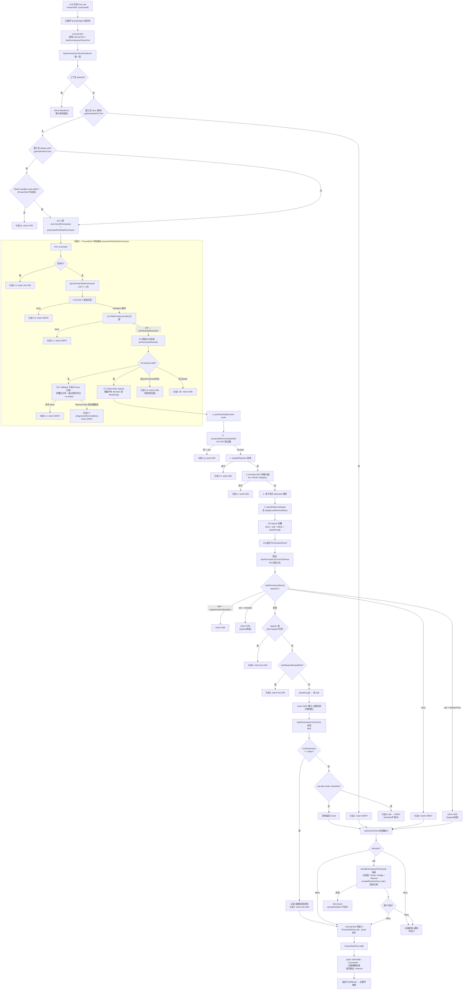

# 一条 PowerShell 语句的完整生命周期：从模型生成到实际执行（全分支遍历）

> 基于源码分析，追踪一条由 LLM 生成的 PowerShell 命令从输出 `tool_use` 块、经过主循环执行器、贯穿通用权限引擎与 PowerShell 专用安全检查、到达用户决策协调器、最终落到 `pwsh` 进程的**每一个判断分支**。
>
> 核心入口：
>
> - 主循环执行器：[services/tools/StreamingToolExecutor.ts](services/tools/StreamingToolExecutor.ts)
> - 通用权限门 [utils/permissions/permissions.ts](utils/permissions/permissions.ts) `hasPermissionsToUseTool` / `hasPermissionsToUseToolInner`
> - PowerShell 专用编排 [tools/PowerShellTool/powershellPermissions.ts](tools/PowerShellTool/powershellPermissions.ts) `powershellToolHasPermission`
> - AST 安全验证 [tools/PowerShellTool/powershellSecurity.ts](tools/PowerShellTool/powershellSecurity.ts) `powershellCommandIsSafe`
> - 决策协调器 [hooks/useCanUseTool.tsx](hooks/useCanUseTool.tsx)
>
> 本文用一个具体命令贯穿全程：`Remove-Item ./secret.txt -Recurse`。

## 目录

1. [总览：两大阶段](#1-总览两大阶段)
2. [阶段 A——模型生成语句](#2-阶段-a模型生成语句)
3. [阶段 B——通用权限引擎](#3-阶段-b通用权限引擎)
4. [阶段 C——PowerShell 专用编排（全分支）](#4-阶段-cpowershell-专用编排全分支)
5. [阶段 D——用户决策协调器](#5-阶段-d用户决策协调器)
6. [阶段 E——实际执行](#6-阶段-e实际执行)
7. [全分支流程图（Mermaid）](#7-全分支流程图mermaid)
8. [关键设计要点总结](#8-关键设计要点总结)

---

## 1. 总览：两大阶段

整个流程分为**两大阶段**：

- **阶段 A｜模型侧**：LLM 生成 `tool_use` 块（还没触碰任何执行、任何安全检查）。
- **阶段 B–E｜运行时侧**：主循环执行器 → 通用权限引擎 → PowerShell 专用安全检查 → 用户决策协调器 → 真正的 `pwsh` 执行。

**贯穿始终的原则：fail-closed（闭锁）**。任何"无法判断"的情况（AST 解析失败、分类器异常、协调器异常、sandbox 策略拒绝）都倾向**拒绝 / 询问**，而不是放行。

---

## 2. 阶段 A——模型生成语句

```
A1. 模型决定需要删除文件
   │
A2. 模型检索 / 已知工具 → 选中 PowerShellTool（tool name = 'PowerShell'）
   │
A3. 按 inputSchema（zod）生成参数 JSON：
   │     { "command": "Remove-Item ./secret.txt -Recurse" }
   │
A4. 输出 tool_use( PowerShell, {command:...} ) 流式返回
   ▼
【进入运行时：主循环 QueryEngine 收到该 tool_use 块并转交给 executeTool】
```

> **潜在分支点**：模型可能生成**非法 JSON / 缺字段**。这会在阶段 B 的 `tool.inputSchema.parse()`（见 B3）处被校验拦截。

---

## 3. 阶段 B——通用权限引擎

### B0. 执行器入口 `executeTool`

收到 `tool_use` 后，执行器在**真正调用 `tool.call()` 之前**，必须通过 `canUseTool`（即 `hasPermissionsToUseTool`）这道总门。**只有返回 `allow` 才会最终执行**。

```
B0. canUseTool(tool, input, context)
   ▼ (进入 B1)
```

### B1. `hasPermissionsToUseToolInner` 第一层——工具级规则（permissions.ts:1158）

```
   B1.0 上下文已中止？ ──是──▶ throw AbortError → 整次调用取消
          │否
   B1.1 整工具被 deny？ getDenyRuleForTool ──有──▶ 【分支1】return deny
          │无
   B1.2 整工具 always-ask？ getAskRuleForTool ──有──▶
          │                        │
          │         ┌──────────────┴──────────────┐
          │  PowerShell？ 否 / 无法 sandbox 自动放行 │
          │         ─▶【分支2a】return ask         │
          │  （Bash + sandbox auto-allow 是特判，  │
          │    PowerShell 不适用）                 │
          │         ─▶ 可 sandbox 自动放行 → 落到 B1.3 由工具检查
          │
   B1.3 调用工具自身 checkPermissions：
          │  ① tool.inputSchema.parse(input)   ←【分支3】schema 非法→异常→toolPermissionResult=passthrough
          │  ② PowerShellTool.checkPermissions(input, context)
          ▼  结果赋给 toolPermissionResult
```

> ⚠️ **关键**：`hasPermissionsToUseToolInner` 在 B1.3 会**同步等待** PowerShell 的 `checkPermissions` 完整执行。**阶段 C 的所有安全检查正是在 B1.3 这里被串进来的**。

### B2. `PowerShellTool.checkPermissions` → `powershellToolHasPermission`

这一层是 PowerShell 专用编排（collect-then-reduce 结构），返回 `deny` / `ask` / `allow` / `passthrough`。完整分支见**阶段 C**。

### B3. 回到 `hasPermissionsToUseToolInner` 的后续分派

```
   B3  toolPermissionResult 已就绪
   │
   ①  behavior === 'deny' ──是──▶ 【分支4】return deny（工具级拒绝）
   │否
   ②  tool.requiresUserInteraction() && behavior==='ask'
   │                      ──是──▶ return ask（PowerShell 属此类）
   │否
   ③  behavior==='ask' && decisionReason.type==='rule'
           && ruleBehavior==='ask'（内容级 ask 规则）──是──▶ return ask（bypass 免疫）
   │否
   ④  behavior==='ask' && decisionReason.type==='safetyCheck'
           （危险路径类，如 checkPathSafetyForAutoEdit）──是──▶ return ask（bypass 免疫）
   │否
   ⑤  重新 getAppState()（取最新模式）
   ⑥  bypass？ mode==='bypassPermissions'
       或 mode==='plan' && isBypassPermissionsModeAvailable ──是──▶ 【分支5】return allow
   │否
   ⑦  整工具 always-allow？ toolAlwaysAllowedRule ──是──▶ 【分支6】return allow
   │否
   ⑧  behavior==='passthrough'？ ──是──▶ 转换为 ask
   │                                        （无规则命中，默认需审批）
   ⑨  return 最终 result（ask 或 allow）
   ▼
【进入 B4 的外层状态机】
```

> 注意 B3-②：`requiresUserInteraction` 为真的工具（PowerShell 属破坏性/需交互类），即使 `behavior==='ask'` 也直接返回 ask，不会因其它快捷路径变成 allow。

### B4. `hasPermissionsToUseTool` 外层：auto 状态机 + dontAsk 转换（permissions.ts:473）

```
   B4 result 已产生
   │
   ①  result.behavior === 'allow'
      │   清理连续拒绝计数器（TRANSCRIPT_CLASSIFIER + auto 模式）
      │   【分支7】return allow → 放行执行
      │
   ②  result.behavior === 'ask' && mode === 'dontAsk'
      │   ──是──▶ 【分支8】"ask" 转换为 "deny"（dontAsk 不询问，直接拒绝）
      │
   ③  （其余情况）result 原样返回
      ▼
【B5: 返回给 useCanUseTool 协调器】
```

> **dontAsk 转换放在最后是关键设计**：让任何早退的 `ask` 都无法在 dontAsk 模式下漏成 `allow`。

---

## 4. 阶段 C——PowerShell 专用编排（全分支）

核心函数 [powershellPermissions.ts:639](tools/PowerShellTool/powershellPermissions.ts#L639) `powershellToolHasPermission`。逐层拆解：

```
C0. command = input.command.trim()
   │
C1. 空命令？ ──是──▶ 【分支 C-a】return allow（空命令安全）
   │否
C2. 解析一次 AST：parsed = await parsePowerShellCommand(command)
   │
C3. 先做 EXACT 规则匹配（不依赖 parse 结果）：
   │   powershellToolCheckExactMatchPermission
   │      deny 命中 ──▶ 【分支 C-b】return deny
   │      （ask / allow 暂存，等 parse 结果再决定）
   │
C4. PREFIX/WILDCARD 规则匹配（matchingRulesForInput）
   │     deny 命中 ──▶ 【分支 C-c】return deny
   │     ask 命中 ──▶ 存入 preParseAskDecision（推迟，不早退）
   │
C5. 原始字符串 UNC 检查
   │     含漏洞 UNC 路径 ──▶ 存入 preParseAskDecision
   │
C6. 【分支 C-d】!parsed.valid（解析失败 / pwsh 不可用 / 超时）
   │   ┌──────────────────────────────────────────────────┐
   │   │ C6.1 fallback 子命令 deny 扫描                     │
   │   │   - 反引号/换行折叠，按 [;|\n{}()&] 切分           │
   │   │   - 每条 fragment 规范化后重新跑前缀 deny           │
   │   │   - 命中 ──▶ return deny 【分支C-e】               │
   │   │   - Remove-Item + 危险裸路径                       │
   │   │        ──▶ dangerousRemovalDeny 【分支C-f】         │
   │   └──────────────────────────────────────────────────┘
   │   preParseAskDecision 存在？ ──▶ return ask（带规则归属）
   │   否则 ──▶ return ask（"malformed syntax，无法解析"），无 suggestions
   │
C7. parse 成功，进入 collect-then-reduce 阶段：
   │   把下列每个子决定 push 进 decisions[]
   │
   a. preParseAskDecision（前缀 ask / UNC）——先 push（让它的消息优先）
   b. powershellCommandIsSafe（24 个 AST 验证器）
   │     ┌────────────────────────────────────────────────┐
   │     │ 任一验证器返回 ask → push ask 【分支C-g】        │
   │     │ 验证器见下方明细表                               │
   │     └────────────────────────────────────────────────┘
   c. hasUsingStatements / hasScriptRequirements
   │     （using module / using assembly / #Requires）     ──▶ push ask 【分支C-h】
   d. provider / UNC 参数扫描（env: HKLM: Registry:: 等）  ──▶ push ask 【分支C-i】
   e. 逐子命令 deny/ask 规则（getSubCommandsForPermissionCheck）──▶ push deny/ask 【分支C-j】
   f. checkPathConstraints（路径约束 + dangerousRemovalDeny）──▶ push deny/ask 【分支C-k】
   │
C8. reduce 折叠：优先级 deny > ask > allow > passthrough
   │   （任何 deny 压过任何 ask —— 结构性修复 ask-before-deny 绕过）
   ▼
C9. 返回折叠后的 PermissionResult 给 B1.3
```

### collect-then-reduce 为什么重要

早期版本是**顺序早退**，`Get-Process; Invoke-Expression evil` 中 ask(Get-Process) 会提前返回，deny(Invoke-Expression) 永远轮不到。现在所有检查**先收集**，再统一按 `deny > ask > allow > passthrough` 折叠，**绕过在结构上不可能写出**。

### AST 验证器明细（阶段 C-b）

| 验证器                                           | 拦截语义                                                 |
| ------------------------------------------------ | -------------------------------------------------------- |
| `checkInvokeExpression`                        | `Invoke-Expression` / `iex` ≈ eval → ask           |
| `checkDynamicCommandName`                      | 命令名本身是变量 → ask                                  |
| `checkEncodedCommand`                          | Base64 编码命令 → ask                                   |
| `checkDownloadCradles`                         | `IEX(New-Object WebClient).DownloadString(...)` → ask |
| `checkAddType` / `checkComObject`            | 加载 .NET 类型 / COM 对象 → ask                         |
| `checkDangerousFilePathExecution`              | 执行脚本 / 可执行文件 → ask                             |
| `checkInvokeItem`                              | `Invoke-Item` / `ii`（ShellExecute）→ ask           |
| `checkScheduledTask`                           | 持久化 → ask                                            |
| `checkStartProcess` / `checkWmiProcessSpawn` | 任意进程生成 → ask                                      |
| `checkModuleLoading`                           | 模块加载 → ask                                          |
| `checkRuntimeStateManipulation`                | 别名 / 变量劫持 → ask                                   |
| `checkTypeLiterals`                            | 非 ConstrainedLanguage allowlist 的 .NET 类型 → ask     |
| 其余 10+ 个                                      | 子表达式、可展开字符串、splatting、脚本块注入等 → ask   |

**parse 失败 → 直接 ask（fail-closed）**：对"无法静态判定"场景的统一安全兜底。

---

## 5. 阶段 D——用户决策协调器

`hasPermissionsToUseTool` 返回后，[useCanUseTool.tsx](hooks/useCanUseTool.tsx) 是最终的调度者：

```
D1. 取 result
    │
D2. allow ─▶ 记录（auto 模式登记批准）→ 允许执行 → 进入 executeTool（阶段 E）
    │
D3. deny ─▶ recordAutoModeDenial（auto 模式计数）+ 拒绝通知 → 不执行
    │
D4. ask ─▶ 进入交互决策协调器（handleInteractivePermission）
    │       ┌────────────────────────────────────────────────┐
    │       │ 竞速机制（createResolveOnce / claim，先到先得）  │
    │       │  1. 立即展示 PermissionRequest 对话框           │
    │       │  2. 异步 hooks（PreToolUse）                    │
    │       │  3. 异步 Bash 分类器（speculative，非 PowerShell）│
    │       │  4. bridge(CCR) / channel 中继                 │
    │       └────────────────────────────────────────────────┘
    │
D5. 用户 / 任何来源决定：
    │   allow ─▶ 记录规则 / 建议 → executeTool（阶段 E）
    │   deny  ─▶ 不执行 + 记录
    ▼
D6. 协调器内部异常 ─▶ fail-closed：cancelAndAbort，不执行
```

> **PowerShell 在此层的特殊性**：`useCanUseTool` 的 speculative **Bash** 分类器只服务 Bash（且外部构建 stub 掉）。对 PowerShell，ask **不会**走 speculative 分类器快速放行——它要么走交互对话框，要么（auto 模式 + `POWERSHELL_AUTO_MODE` 未开启）直接降级 deny。

---

## 6. 阶段 E——实际执行

```
E1. canUseTool === 'allow'
   │
E2. executeTool 调用 PowerShellTool.call(...)
   │
E3. PowerShellTool 内部：
   │   - 拼装 pwsh -NoProfile -Command <command>
   │   - WINDOWS_SANDBOX_POLICY_REFUSAL 检查（沙箱策略拒绝 → 报错）
   │   - 流式捕获 stdout/stderr
   │   - timeout / 后台化策略
   │
E4. 返回 ToolResult → 模型拿到结果 → 继续主循环
```

---

## 7. 全分支流程图（Mermaid）

以下为上述所有分支的完整合并图（不含 Bash 分类器在 PowerShell 场景的 stub 分支，仅保留 PowerShell 真实路径）：



---

## 8. 关键设计要点总结

1. **两个独立检查域**：

   - [hasPermissionsToUseTool](utils/permissions/permissions.ts#L473) 是**所有工具共享**的通用门（工具级 deny/ask/allow + 模式状态机）。
   - [powershellToolHasPermission](tools/PowerShellTool/powershellPermissions.ts#L639) 是 **PowerShell 专用**的深度检查（AST 级安全）。
   - 二者串联，最危险工具获得最深的静态分析。
2. **deny 优先，处处 fail-closed**：工具级 deny > 内容级 deny > ask 规则 > safetyCheck > allow；任何"无法判断"（parse 失败、分类器异常、协调器异常）都倾向**拒绝 / 询问**而非放行。
3. **collect-then-reduce 防绕过**：PowerShell 编排不顺序早退，而是收集全部子决定后按 `deny > ask > allow > passthrough` 折叠，结构性杜绝 ask-before-deny 绕过。
4. **dontAsk 转换在最后**：`ask → deny` 的转换放在所有早退之后，保证任何路径的 ask 都不会在 dontAsk 模式下漏成 allow。
5. **PowerShell 不走 speculative 分类器**：`POWERSHELL_AUTO_MODE`（ant-only flag）未开启时，PowerShell 被排除在 auto-mode LLM 分类器之外；其安全完全依赖确定性的 AST 验证器，LLM 分类器只在 ask 交互阶段作为旁路兜底（且外部构建 stub 掉）。
