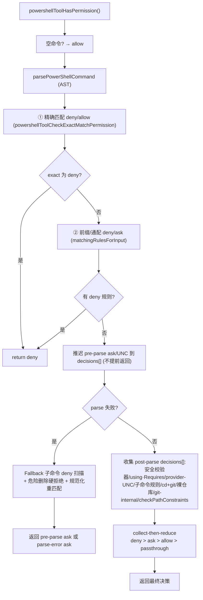

# Claude Code PowerShell 工具深度拆解（安全防御策略）

> 基于源码分析，从 Schema 定义、权限检查（AST+collect-then-reduce）、多级安全校验器、路径约束、git 防护、外部命令稳妥放行到 Windows 沙箱策略的完整安全链路。
> 核心文件：`src/tools/PowerShellTool/`
>
> 本文重点：**安全防御策略**。与 bash 相比，PowerShell 工具在权限检查上增加了「AST 子命令级拆分 + collect-then-reduce 决策归并 + 多级 heuristic 安全校验器 + 参数类型白名单（elementTypes）」几层纵深防御。

## 目录

1. [架构总览](#1-架构总览)
2. [输入 Schema 定义](#2-输入-schema-定义)
3. [安全防线总览（纵深防御）](#3-安全防线总览纵深防御)
4. [模型提示词（prompt）](#4-模型提示词prompt)
5. [权限检查（powershellToolHasPermission）](#5-权限检查powershelltoolhaspermission)
6. [多级安全校验器（powershellSecurity）](#6-多级安全校验器powershellsecurity)
7. [只读与参数类型白名单（readOnlyValidation）](#7-只读与参数类型白名单readonlyvalidation)
8. [路径约束与危险删除（pathValidation）](#8-路径约束与危险删除pathvalidation)
9. [git 安全协议](#9-git-安全协议)
10. [Windows 沙箱策略拦截](#10-windows-沙箱策略拦截)
11. [命令执行（call）](#11-命令执行call)
12. [结果映射（mapToolResult）](#12-结果映射maptoolresult)
13. [关键源码速查](#13-关键源码速查)
14. [调用链条与安全防御流程总图](#14-调用链条与安全防御流程总图)

---

## 1. 架构总览

PowerShell 工具通过 `buildTool()`（`src/Tool.ts`）构造，定义横跨多个文件。它是 **Windows 原生** 的命令执行工具（`pwsh`/`powershell.exe`），因此在沙箱策略上与 Bash 不同——**原生 Windows 没有沙箱**，当「企业策略强制要求沙箱但 unsandboxed 命令不被允许」时，工具会**整体拒绝执行**（而不是像 Bash 那样降级）。

```
Schema 定义 (PowerShellTool.tsx)
  → 权限检查 (powershellPermissions.ts · powershellToolHasPermission)
      ├── 多级安全校验器 (powershellSecurity.ts · powershellCommandIsSafe)
      ├── 只读/参数白名单 (readOnlyValidation.ts · isReadOnlyCommand/isAllowlistedCommand)
      ├── 路径约束/危险删除 (pathValidation.ts · checkPathConstraints/dangerousRemovalDeny)
      └── git 安全 (gitSafety.ts + powershellPermissions.ts 内的 GIT_SAFETY_* 常量)
  → 命令执行 (call → runPowerShellCommand → spawnShellTask)
  → 结果映射 (mapToolResultToToolResultBlockParam)
  → UI 展示 (UI.tsx)
```

**关键文件分布**：

| 文件                             | 职责                                                                                   |
| -------------------------------- | -------------------------------------------------------------------------------------- |
| `PowerShellTool.tsx`           | 工具定义、input/output Schema、`call`/`validateInput`/`isReadOnly` 主体          |
| `powershellPermissions.ts`     | **主权限检查**（`powershellToolHasPermission`、collect-then-reduce、git 防护） |
| `powershellSecurity.ts`        | **多级 heuristic 安全校验器**（Invoke-Expression、下载、编码命令等 22+ 检查）    |
| `readOnlyValidation.ts`        | 只读判定 +**参数类型白名单（elementTypes）** + 命令别名规范化                    |
| `pathValidation.ts`            | 路径约束校验、危险删除硬拒绝、CD 复合命令守卫                                          |
| `modeValidation.ts`            | 模式相关校验（isSafeOutputCommand 等辅助）                                             |
| `gitSafety.ts`                 | 外部 git 文件操作安全                                                                  |
| `commandSemantics.ts`          | 退出码语义解释                                                                         |
| `commonParameters.ts`          | `COMMON_PARAMETERS`（每个 cmdlet 都接受的通用参数）                                  |
| `destructiveCommandWarning.ts` | 破坏性命令警告                                                                         |
| `clmTypes.ts`                  | CLM 允许类型                                                                           |
| `prompt.ts`                    | 模型面向的提示词（`getPrompt`）                                                      |
| `toolName.ts`                  | 工具名常量（`POWERSHELL_TOOL_NAME = 'PowerShell'`）                                  |
| `UI.tsx`                       | 工具 UI 渲染组件                                                                       |

### 工具对象定义要点

`PowerShellTool = buildTool({...})`（`PowerShellTool.tsx:272`）声明了几个关键配置：

- `name: POWERSHELL_TOOL_NAME`（即 `'PowerShell'`）
- `searchHint: 'execute Windows PowerShell commands'`
- `maxResultSizeChars: 30_000`
- `description()`：返回 `description || 'Run PowerShell command'`
- `prompt()`：返回 `getPrompt()`
- `isReadOnly()`：**同步** heuristic → `isReadOnlyCommand`（无 AST，仅能处理最小命令）。
- `isConcurrencySafe()`：跟随 `isReadOnly`。
- `isSearchOrReadCommand()`：用于 UI 折叠。

---

## 2. 输入 Schema 定义

输入 Schema 定义于 [`PowerShellTool.tsx:228-234`](../src/tools/PowerShellTool/PowerShellTool.tsx#L228)，用 zod `z.strictObject` 声明：

```typescript
const fullInputSchema = lazySchema(() => z.strictObject({
  command: z.string().describe('The PowerShell command to execute'),
  timeout: semanticNumber(z.number().optional()).describe(`Optional timeout in milliseconds (max ${getMaxTimeoutMs()})`),
  description: z.string().optional().describe('Clear, concise description of what this command does in active voice.'),
  run_in_background: semanticBoolean(z.boolean().optional()).describe(`Set to true to run this command in the background. Use Read to read the output later.`),
  dangerouslyDisableSandbox: semanticBoolean(z.boolean().optional()).describe('Set this to true to dangerously override sandbox mode and run commands without sandboxing.')
}));
```

### 各字段语义

| 字段                          | 类型           | 用途                                      |
| ----------------------------- | -------------- | ----------------------------------------- |
| `command`                   | string（必填） | 要执行的 PowerShell 命令                  |
| `timeout`                   | number?        | 超时（毫秒），上限`getMaxTimeoutMs()`   |
| `description`               | string?        | **活动描述（UI 展示）**，不参与执行 |
| `run_in_background`         | boolean?       | 后台异步执行，完成后通知                  |
| `dangerouslyDisableSandbox` | boolean?       | 禁用沙箱（Windows 上受策略约束）          |

### 隐藏字段

与 Bash 不同，PS 没有 `_simulatedSedEdit` 隐藏字段（无 sed 就地编辑预览）。当 `CLAUDE_CODE_DISABLE_BACKGROUND_TASKS` 设置时，`run_in_background` 从 schema 中省略（`:237-239`），但代码仍通过 `PowerShellToolInput` 类型处理它（保持运行时兼容）。

---

## 3. 安全防线总览（纵深防御）

PowerShell 工具的安全不是单点检查，而是**多层重叠**的纵深防御。任何单层被绕过，下一层仍可拦截：

```
第 0 层：Windows 沙箱策略门 (call/validateInput)         —— 政策强制，整体拒绝
第 1 层：输入校验 validateInput                           —— 拦截阻塞模式、策略违规
第 2 层：parsePowerShellCommand (AST 解析)               —— 失败→拒绝/降级为 ask
第 3 层：中任 deny/ask 规则（精确+前缀/通配，含 AST 规范化）—— 用户配置
第 4 层：powershellCommandIsSafe 安全校验器（22+ 检查）    —— heuristic 危险模式
第 5 层：using/#Requires 语句检查                          —— 外部代码加载
第 6 层：provider/UNC 扫描（HKLM:/env:/UNC→NTLM 泄漏）     —— 凭据保护
第 7 层：子命令级规则匹配 + collect-then-reduce            —— 拆分子命令防绕过
第 8 层：cd+git / bare-git-repo / git-internal-paths 守卫  —— git 攻击面
第 9 层：checkPathConstraints 路径约束 + 危险删除硬拒绝     —— 文件系统边界
第 10 层：isReadOnlyCommand 参数类型白名单（elementTypes）  —— 只读自动放行
第 11 层：结果映射（大输出持久化/图像处理）                 —— 结果安全
```

**核心设计哲学**体现在源码注释里反复出现的关键词：

- **fail-closed（安全失败）**：无法解析、元素类型未知、解析降级时一律拒绝/ask，绝不放行。
- **deny > ask > allow**：权限检查的优先级，deny 永远不能被 ask 遮蔽（collect-then-reduce 结构性保证）。
- **nameType gate**：防止「无害命令名 + 本地脚本(相对路径/模块限定)」绕过。
- **TOCTOU 防护**：cd、symlink、归档解压导致的「检查时 vs 运行时路径不一致」。

---

## 4. 模型提示词（prompt）

`getPrompt()`（[`prompt.ts:73`](../src/tools/PowerShellTool/prompt.ts#L73)）动态拼接面向模型的完整工具使用说明：

```
Executes a given PowerShell command with optional timeout. Working directory persists between commands; ...
IMPORTANT: This tool is for terminal operations via PowerShell: git, npm, docker, and PS cmdlets.
  DO NOT use it for file operations (reading, writing, editing, searching, finding files) - use the specialized tools.
# PowerShell Edition 版本差异指导 (getEditionSection)
# 目录校验 / 命令执行步骤
# 语法注意（$变量、反引号转义、Verb-Noun 等）
# 交互/阻塞命令警告（-NonInteractive，禁止 Read-Host/Get-Credential/Out-GridView/pause）
# 多行字符串/here-string 语法
# 后台任务 / Start-Sleep 指导（getBackgroundUsageNote / getSleepGuidance，禁用时返回 null）
# 工具分工（用 Glob/Grep/FileRead/FileEdit/FileWrite 而非 Get-ChildItem/Select-String/...）
# git 提交/PR 安全协议
```

**安全相关的提示词要点**：

- **版本差异**（`getEditionSection`，`:51`）：模型无法判断自己目标是哪个版本，提示词主动按检测到的 `PowerShellEdition`（desktop/core/unknown）给出对应语法，避免 5.1 解析错误（exit 1）或 7 上不必要的规避。
- **交互命令警告**：工具以 `-NonInteractive` 运行，明确禁止 `Read-Host`/`Get-Credential`/`Out-GridView`/`pause` 等会挂死的命令。
- **工具分工**：督促优先使用专门的只读工具（FileRead/Glob/Grep），减少对 shell 的依赖——这也是安全面收窄的一部分。
- **git 安全**：禁止 `--no-verify`/`--no-gpg-sign` 绕过钩子与签名，破坏性操作先评估更安全替代。

---

## 5. 权限检查（powershellToolHasPermission）

主权限检查函数 `powershellToolHasPermission()`（[`powershellPermissions.ts:639`](../src/tools/PowerShellTool/powershellPermissions.ts#L639)），在 `checkPermissions`（`PowerShellTool.tsx:375`）中被调用。**这是 PS 工具安全的核心**，结构上先做「pre-parse 顺序检查」（解析失败也要执行），再做「post-parse collect-then-reduce」（收集所有决策后统一按优先级归并）。

### 5.1 分阶段流程



### 5.2 pre-parse 阶段（解析前就要执行）

这些检查**不依赖 AST**，因此即使 `pwsh` 不可用/解析超时/命令超长（`valid=false`）也会执行：

1. **空命令检查**（`:646`）：直接 allow，「Empty command is safe」。
2. **精确匹配**（`:665`，`powershellToolCheckExactMatchPermission`）：命中 deny 直接返回。
3. **前缀/通配 deny/ask**（`:676`，`matchingRulesForInput(..., 'prefix')`）：有 deny 规则直接返回 deny。
4. **推迟而非早退**（`:694`）：前缀 ask 和 UNC 检查现在**存入 `preParseAskDecision` 而不是提前 return**。这是关键安全修复——以前 `Get-Process; Invoke-Expression evil` 配 `ask(Get-Process:*)` + `deny(Invoke-Expression:*)` 时，ask 对话框会先出现，deny 永远不触发。现在推迟后由 collect-then-reduce 保证 deny 优先。
5. **UNC 路径检查**（`:717`，`containsVulnerableUncPath`）：UNC 读取可能触发网络请求、泄漏 **NTLM/Kerberos 凭据**，标记 ask。
6. **parse 失败 fallback 扫描**（`:764`，注释详尽）：当 `!parsed.valid`（超长、pwsh 不可用、坏 JSON），**防御性降级**为基于正则/分隔符的碎片扫描：

   - 按 `;| \n\r {}() &` 拆成碎片（**反引号不是分隔符**，先折叠反引号换行续行再剥离转义反引号，防 `Invoke-Ex`\`pression` 被拆碎）。
   - 每条碎片走与 step 2a 相同的 deny 规则匹配器。**这堵住了 `Get-ChildItem # <padding>; Invoke-Expression evil` 用 padding 强制 valid=false 绕过 deny 的攻击**。
   - **危险删除硬拒绝**（`:833`）：`resolveToCanonical(firstTok) === 'remove-item'` 时对位置参数做 `isDangerousRemovalRawPath` 检查，命中即 `dangerousRemovalDeny`——即使解析降级，`Remove-Item /` 也会被硬拒绝而不是降级为 ask。
   - **规范化重匹配**（`:816`）：剥离 `$x = ` 赋值前缀、`& ` / `. ` 调用操作符前缀后再匹配规则，防 `$x = Invoke-Expression 'p'` / `. Invoke-Expression` / `& 'Invoke-Expression'` 首 token 不是命令名的绕过。
7. **exact-allow 逃生门**（`:750`）：当 `parse 失败` 且 `pre-parse ask 为空` 且首 token 分类**不是** `'application'` 时，exact allow 生效。`classifyCommandName` 是纯字符串函数，`scripts\build.exe`（含 `\`）→ `'application'` → 逃生门不触发 → 降级为 ask。**fail-safe**：本地脚本执行不会被意外放行。

### 5.3 post-parse 阶段（collect-then-reduce）

一旦解析成功，所有后续检查的结果 push 进一个 `decisions[]` 数组，最后用一次 reduce 应用优先级规则（`deny > ask > allow > passthrough`）。这是从 `bashPermissions.ts:1446-1472` 移植的**结构性关闭 ask-before-deny bug 类**的关键模式——单靠「stash 补丁」无法防止未来作者写出 `return ask`。

**决策来源（按收集顺序，同行为首者胜）**：

| 决策                              | 检查                                                      | 说明                                  |
| --------------------------------- | --------------------------------------------------------- | ------------------------------------- |
| pre-parse ask                     | 2b 前缀规则 / UNC                                         | 先 push，消息优先，但 deny 仍能压过它 |
| **多级安全校验器**          | `powershellCommandIsSafe`                               | 见 §6，ask 或 passthrough            |
| **using/#Requires**         | `parsed.hasUsingStatements` / `hasScriptRequirements` | 见 §5.4                              |
| **provider/UNC 参数扫描**   | `providerOrUncDecisionForArg`                           | 见 §5.5                              |
| **子命令级别规则**          | 每个子命令 deny/ask                                       | 见 §5.6                              |
| **cd+git 守卫**             | `hasCdSubCommand && hasGitSubCommand`                   | 见 §5.7                              |
| **裸仓库守卫**              | `hasGitSubCommand && isCurrentDirectoryBareGitRepo()`   | 见 §5.7                              |
| **git-internal-paths 守卫** | `GIT_SAFETY_WRITE_CMDLETS` + 归档解压器                 | 见 §9                                |
| **checkPathConstraints**    | `checkPathConstraints(parsed, ..., hasCdSubCommand)`    | 见 §8                                |

### 5.4 using / #Requires 语句检查

这些语句**对 AST block 遍历不可见**（它们是 `ScriptBlockAst` 的兄弟而非子节点，`Process-BlockStatements` 和所有下游命令遍历器都看不到它们）：

- `using module ./evil.psm1`：加载并执行模块顶层脚本体。
- `using assembly ./evil.dll`：加载 .NET 程序集（模块初始化器执行）。
- `#Requires -Modules <name>`：从 PSModulePath 触发模块加载。

**攻击示例**：`using module ./evil.psm1; Get-Process`——`Get-Process` 填充 subCommands，绕过空语句 fallback，且 `isReadOnlyCommand` 会 auto-allow。此检查确保这类命令被 ask 拦截。

### 5.5 provider / UNC 参数扫描

`extractProviderPathFromArg` + `providerOrUncDecisionForArg`（`:983`）对每个子命令的每个参数检查：

- **非文件系统 provider 前缀**：`NON_FS_PROVIDER_PATTERN = /^(?:[\w.]+\\\\)?(env|hklm|hkcu|function|alias|variable|cert|wsman|registry)::?/i`——`env:`、`HKLM:`、`function:` 等访问非文件系统资源。
  - **安全细节**：PS tokenizer 接受 en-dash/em-dash/horizontal-bar（U+2013/2014/2015）作为参数前缀。`–Path:env:HOME`（en-dash）也必须剥离 `–Path:` 前缀，否则 `^` 锚定的 pattern 匹配不上。**必须先剥离 dash 前缀再匹配**。
  - **转义处理**：剥离反引号转义（`\`Registry\`::HKLM\...\` 中的反引号在运行时被 PS 移除，不剥离会挡住 `^` 锚定匹配）。
- **UNC 路径**：`containsVulnerableUncPath(value)`——NTLM/Kerberos 凭据泄漏。**raw-string 检查漏掉反引号转义形式；cmd.args 的反引号转义已被 parser 解析**，两处互补。

### 5.6 子命令级别规则匹配 + 规范化

`getSubCommandsForPermissionCheck()`（`:539`）把复合命令拆成子命令分别匹配权限规则。关键安全点：

- **只处理 `CommandAst`**（跳过表达式/变量）。
- **AST 规范化命令串**（`:1064`，`canonicalSubCmd = element.name + element.args.join(' ')`）——**deny 和 allow 必须用同一规范化形式，堵住不对称**：
  - 调用操作符 `& 'Remove-Item' ./x`：原始文本以 `&` 开头，按空白切分得到的是操作符而非 cmdlet 名。
  - 非空白空白 `rm\t./x`：原始前缀匹配用 `prefix + ' '`（字面空格），但 PS 接受任意空白分隔符——`checkPermissionMode` 自动放行（用 AST cmd.name）能匹配而 deny 规则匹配不到 → **deny 绕过**。
  - 模块前缀 `Microsoft.PowerShell.Management\Remove-Item`：element.name 已剥离模块前缀。
- **isSafeOutput 门控**（`:582`）：`isSafeOutput` 仅在 `cmd.nameType !== 'application' && isSafeOutputCommand && args.length === 0` 时为 true。这防止：
  - `scripts\Out-Null`（nameType gate）：剥离后匹配 SAFE_OUTPUT_CMDLETS，但 PS 运行 .ps1 文件——若 isSafeOutput=true 会被 step 5 从批准列表过滤掉而**静默执行**。
  - `Out-Null -InputObject:(1 > /etc/x)`：args.length===0 门控防止「仅按名字过滤」→ 重定向写文件。

### 5.7 git 复合命令守卫

- **cd+git 复合**（`:1139`）：`hasCdSubCommand && hasGitSubCommand` → ask。「cd 到恶意目录让 git 危险」（假 hooks、裸仓库攻击）。
  - **安全细节**：**不做 cd-to-CWD no-op 排除**——`Set-Location -Path:/etc .` 会让「首个非 dash 参数」启发式误判 target 为 `.`，排除逻辑触发而绕过。所以**只要复合命令含任何 cd 族 cmdlet 就置位**，无论目标是什么。
  - 仅当 `allSubCommands.length > 1` 才 flag 复合 cd：单独的 `Set-Location ./subdir` 不是 TOCTOU 风险（后续无语句相对路径解析）。
- **symlink 创建复合守卫**（`:1133`）：创建文件系统链接后，通过链接的后续写入落在验证器视野之外，与 cd 失步同构。
- **裸仓库守卫**（`:1160`）：cwd 有 `HEAD`/`objects/`/`refs/` 但无有效 `.git/HEAD` 时，git 视 cwd 为裸仓库并从 cwd 运行 hooks → ask。移植自 `BashTool isCurrentDirectoryBareGitRepo`。
- **git-internal-paths 写守卫**（`:1173`）：复合命令创建 `HEAD`/`objects/`/`refs/`/`hooks/` 后运行 git → 执行新创建的恶意 hooks。检查所有写路径 + 重定向目标是否匹配 git-internal 模式（`GIT_SAFETY_WRITE_CMDLETS` + `GIT_SAFETY_ARCHIVE_EXTRACTORS`，见 §9）。

### 5.8 reduce 归并

权限结果优先级：**deny > ask > allow > passthrough**。数组顺序 = 步骤顺序，`first-of-each-behavior wins`——因此单条 ask 消息与旧顺序相对 unchanged，但任何后续 deny 都能压过前面的 ask。这结构性杜绝了「先 ask 后 deny 被遮蔽」的 bug 类。

**绕过示例**：

- `Get-Process; Invoke-Expression evil` 配 `ask(Get-Process:*)` + `deny(Invoke-Expression:*)` → 现在 deny 赢。
- `Set-Location ~; Get-Content ./.ssh/id_rsa`（find #27）→ isReadOnly 自动放行路径 + 路径校验用旧 cwd → 现在 cd 复合守卫拦截。

---

## 6. 多级安全校验器（powershellSecurity）

`powershellCommandIsSafe()`（[`powershellSecurity.ts:1042`](../src/tools/PowerShellTool/powershellSecurity.ts#L1042)）串行运行 **22 个 validator**，任一返回 `ask` 即中断：

```typescript
const validators = [
  checkInvokeExpression,      // Invoke-Expression / iex ≈ eval
  checkDynamicCommandName,    // 命令名本身是动态的(& / Get-Command -Name $x)
  checkEncodedCommand,        // -EncodedCommand / [Convert]::FromBase64String
  checkPwshCommandOrFile,     // pwsh -Command / -File 嵌套执行
  checkDownloadCradles,       // IEX((New-Object Net.WebClient).DownloadString(...)) 下载执行
  checkDownloadUtilities,     // Invoke-WebRequest / curl / certutil 等下载工具
  checkAddType,               // Add-Type -TypeDefinition 编译运行 C#
  checkComObject,             // New-Object -ComObject → 任意 COM 对象
  checkDangerousFilePathExecution, // 直接执行危险文件路径
  checkInvokeItem,            // Invoke-Item -Path 打开/执行
  checkScheduledTask,         // 计划任务持久化
  checkForEachMemberName,     // ForEach 成员敏感操作
  checkStartProcess,          // Start-Process 任意进程
  checkScriptBlockInjection,  // 脚本块注入
  checkSubExpressions,        // $(...) 子表达式
  checkExpandableStrings,     // "$var" 可展开字符串
  checkSplatting,             // @args 可变参数转发
  checkStopParsing,           // --% 停止解析
  checkMemberInvocations,     // 成员调用 .Method()
  checkTypeLiterals,          // [type]::Method() 类型字面量
  checkEnvVarManipulation,    // 环境变量修改 (ENV_WRITE_CMDLETS / $env: 赋值)
  checkModuleLoading,         // Import-Module / Install-Module 等模块加载
  checkRuntimeStateManipulation, // Set-Alias / New-Alias 劫持未来命令解析
  checkWmiProcessSpawn,       // Invoke-WmiMethod / Invoke-CimMethod (Win32_Process Create)
]
```

### 代表性检查器

**`checkInvokeExpression`**（`:106`）：`hasCommandNamed(parsed, 'Invoke-Expression')` → ask。Invoke-Expression 等价 eval，可执行任意代码。

**`checkEnvVarManipulation`**（`:908`）：`getVariablesByScope(parsed, 'env')` 找到 `$env:` 变量，若存在 `ENV_WRITE_CMDLETS` 写 cmdlet **或** `deriveSecurityFlags(parsed).hasAssignments && envVars > 0` → ask。防止 `$env:SECRET` 被修改/泄漏。

**`checkModuleLoading`**（`:946`）：`MODULE_LOADING_CMDLETS.has(lower)` → ask。`Import-Module` 会执行 .psm1 顶层脚本体（任意代码）。

**`checkRuntimeStateManipulation`**（`:982`）：`RUNTIME_STATE_CMDLETS`（Set-Alias/New-Alias 等）→ ask。**模块限定符剥离**：`Microsoft.PowerShell.Utility\Set-Alias` → `set-alias`。Set-Alias 可劫持未来命令解析。

**`checkWmiProcessSpawn`**（`:1016`）：`WMI_SPAWN_CMDLETS`（Invoke-WmiMethod/Invoke-CimMethod）→ ask，可经 `Win32_Process Create` 派生任意进程。

**关键设计**：若 `!parsed.valid`（解析失败），无法确定安全性 → **ask**（fail-closed）。

---

## 7. 只读与参数类型白名单（readOnlyValidation）

### 7.1 只读判定 `isReadOnlyCommand`

`isReadOnlyCommand()`（[`readOnlyValidation.ts:1168`](../src/tools/PowerShellTool/readOnlyValidation.ts#L1168)）判定命令是否只读（可并发/可自动放行）。**是 fail-closed**：

- 无 AST / 解析失败 → **false**（拒绝只读）。
- **deriveSecurityFlags 拒绝**：`hasScriptBlocks / hasSubExpressions / hasExpandableStrings / hasSplatting / hasMemberInvocations / hasAssignments / hasStopParsing` 任一为 true → false。例：`Get-Process | ForEach-Object { Remove-Item C:\foo }` 管道看似安全但脚本块含破坏代码。
- **cd 复合防绕过**（`:1209`，find #27）：复合命令含 cwd 改变 cmdlet（Set-Location/Push-Location/Pop-Location/New-PSDrive）→ false。例：`Set-Location ~; Get-Content ./.ssh/id_rsa` —— 两者都在 CMDLET_ALLOWLIST，无此守卫自动放行；路径校验用旧 cwd 会漏掉 `Read(~/.ssh/**)` deny 规则。
- **文件重定向拒绝**：非 `$null` 目标的重定向 → false（`> $null` 丢弃输出不算文件系统写）。
- **管道第一命令必须在白名单**（`isAllowlistedCommand`），后续命令须是安全输出 cmdlet 或白名单（带参数校验）。
- **nestedCommands 拒绝**（`:1293`）：语句含嵌套命令（脚本块参数、冒号绑定参数的 Paren 子节点）→ false。这是定义上**不是简单只读调用**，包含绕过 per-command 白名单检查的可执行子管道。

**同步限制**：`Tool.isReadOnly()`（`PowerShellTool.tsx:300`）是同步接口，先跑 `hasSyncSecurityConcerns`（正则检测子表达式/splatting/成员调用/赋值）→ false，再调 `isReadOnlyCommand` 无 AST 版本 → 极简命令才返回 true。真正的只读自动放行在 `powershellToolHasPermission`（async，AST 可用）中完成（step 4.5）。

### 7.2 `isSafeOutputCommand`（name-only 检查）

`SAFE_OUTPUT_CMDLETS`（`:888`）**只含 `out-null`**——注释详尽解释为何其他输出 cmdlet 被移除：

- **NOT out-string/out-host**：两者接受 `-InputObject`，泄漏方式同 Write-Output。`Get-Process | Out-String -InputObject $env:SECRET`——名字被过滤，但 `$env` 参数从未被校验。
- **NOT foreach-object/where-object/select-object/sort-object/group-object/format-* /measure-object**：全部接受计算属性 hashtable 或脚本块谓词，运行时求任意表达式：
  - `Where-Object @{k=$env:SECRET}`（HashtableAst，'Other'）
  - `Select-Object @{N='x';E={...}}`（计算属性脚本块）
  - `Format-Table $env:SECRET`（位置 -Property，打印成表头）
  - `Measure-Object -Property $env:SECRET`（经「property 'sk-...' not found」泄漏）
  - `ForEach-Object { $env:PATH='e' }`（任意脚本体）
- **NOT write-output**：`$env:SECRET | Write-Output`——管道首元素是 VariableExpressionAst，被 `getSubCommandsForPermissionCheck` 跳过（非 CommandAst）。若 write-output 在 SAFE_OUTPUT_CMDLETS，会被过滤为 safe-output → 空 subCommands → auto-allow → 秘密打印。

**isSafeOutput 的 nameType gate**：仅当 `cmd.nameType !== 'application' && args.length === 0` 才算 true（见 §5.6）。

### 7.3 参数类型白名单 `isAllowlistedCommand`

`isAllowlistedCommand()`（`:1310`）是只读自动放行的核心，**逐参数验证类型**：

1. **nameType gate**（`:1322`）：`cmd.nameType === 'application'` 意味着原始名字含路径字符（`.` `\` `/`）——如 `scripts\Get-Process`、`./git`、`node.exe`，PS 视为文件路径而非要匹配的 cmdlet。**绝不自动放行**；除非原始首 token 在 `SAFE_EXTERNAL_EXES`（`where.exe` 等）。已知 collateral：`Microsoft.PowerShell.Management\Get-ChildItem` 也分类为 application 会 prompt——可接受因为提示是安全的。
2. **匹配 `lookupAllowlist(cmd.name)`** 的 CMDLET_ALLOWLIST 配置；无配置 → false。
3. **arg elementTypes 白名单（关键）**（`:1350`）：只接受 `StringConstant` 和 `Parameter`，其余都在运行时展开/求值 → 拒绝：

   - `'Variable'` → `Get-Process $env:AWS_SECRET_ACCESS_KEY` 展开，报错 "Cannot find process 'sk-ant-...'"，**模型从错误里读秘密**。
   - `'Other' (Hashtable)` / `'Other' (Convert)` / `'Other' (BinaryExpr)` / `'SubExpression'` 同理。
   - **elementTypes undefined → fail-closed**（真实 parser 总是设置它，undefined 意味着不可信/恶意元素）。
   - **metachar 检查**：`/[$(@{[]/` 测试 arg 文本——Hashtable `@{`、Convert `[`、BinaryExpr-with-var `$`、ParenExpr `(`。裸逗号列表（`Get-Process Name, Id` → 'Other'/ArrayLiteralAst）无 metachar 则放行。
   - **冒号绑定参数**（`:1409`）：`-Flag:$env:SECRET` 是单个 CommandParameterAst，其 VariableExpressionAst 是 .Argument 子节点。**查询 parser 的 children[] 树**（`cmd.children[i-1]`）比字符串考古更强——`-InputObject:@{k=v}`（HashtableAst，无 `$` 在文本）、`-Name:('payload' > file)`（带重定向的 ParenExpressionAst）。
4. **外部命令转发**（`:1432`）：git/gh/docker/dotnet → `isExternalCommandSafe`（§9）。
5. **flag 校验**：`allowAllFlags` 跳过；`safeFlags` 为空 → 「仅位置参数，拒绝所有 flag」的**安全默认**（不是「接受一切」）。cmdlet 用 `isPowerShellParameter` + elementTypes 作为 flag 检测 ground truth（**PS tokenizer 接受 Unicode dash 作参数前缀**，`startsWith('-')` 会漏 `–ComputerName`）。`COMMON_PARAMETERS`（`-ErrorAction/-Verbose/-Debug` 等，每个 [CmdletBinding()] cmdlet 都接受）统一豁免。

---

## 8. 路径约束与危险删除（pathValidation）

### 8.1 `checkPathConstraints`

`checkPathConstraints()`（[`pathValidation.ts:1528`](../src/tools/PowerShellTool/pathValidation.ts#L1528)）**两遍法检查所有语句**：

- 解析失败 → passthrough（无法验证，但其他层已处理）。
- **两遍：先扫全部语句，deny 永远优先于 ask**（`:1541`）——防止「语句 1 的 ask 提前返回，没检查语句 2 的 deny 规则，用户批准了含拒绝路径的命令」。
- 逐语句 `checkPathConstraintsForStatement`：deny 立即返回；ask 记 `firstAsk`；扫完返回 `firstAsk ?? passthrough`。
- 接收 `compoundCommandHasCd`（来自 §5.7 的 cd 守卫），cd 复合中**任何**路径操作（读或写）都 ask。

### 8.2 危险删除硬拒绝

`dangerousRemovalDeny()`（`:848`）返回 `deny`：「`Remove-Item` on system path 'X' is blocked」。`isDangerousRemovalPath`（resolveToCanonical + Path 展开后判断根目录/家目录/系统路径）。

**parse 降级时的防御**（§5.2）：`checkPathConstraintsForStatement` 需要有效 AST；pwsh 超时/不可用时 `Remove-Item /` 会从硬拒绝降级为通用 ask。fallback 扫描在 parse 失败路径检查原始位置参数（跳过 `-Param` token），命中即 `dangerousRemovalDeny`——**reject-down 修复在降级态依然生效**。

---

## 9. git 安全协议

### 9.1 git-internal 写 cmdlet（`GIT_SAFETY_WRITE_CMDLETS`）

`powershellPermissions.ts:70`：能按调用者指定路径放置文件的 cmdlet：

```typescript
new-item, set-content, add-content, out-file, copy-item, move-item,
rename-item, expand-archive, invoke-webrequest, invoke-restmethod,
tee-object, export-csv, export-clixml
```

`git-internal-paths` 守卫检查任一参数是否为 git-internal 路径（hooks/、refs/、objects/、HEAD）。**非创建型写入器（remove-item、clear-content）有意缺席**——它们无法种植新 hooks。

### 9.2 归档解压器（`GIT_SAFETY_ARCHIVE_EXTRACTORS`）

`:96`：`tar/bsdtar/unzip/7z/7za/gzip/gunzip/expand-archive`。**这些按名字匹配**（小写，带不带 .exe）。

**这是 TOCTOU 修复**：`tar -xf payload.tar; git status` 会打败 `isCurrentDirectoryBareGitRepo`——检查在权限评估时运行，tar 在检查之后、git 运行之前解压出 HEAD/hooks/refs/。与 `GIT_SAFETY_WRITE_CMDLETS`（能检查参数）不同，**归档内容是 opaque 的**——任何在 git 之前的归档解压都必须 ask。

### 9.3 外部命令安全（`isExternalCommandSafe`）

`git/gh/docker/dotnet` 转发到共享校验（`DANGEROUS_GIT_GLOBAL_FLAGS` 等）。`resolveToCanonical` 剥离 Windows PATHEXT（`.exe/.cmd/.bat/.com`）——但**仅在名字无路径分隔符时**：`git.exe` → `git` 触发 git 安全守卫；`scripts\git.exe`（相对路径，运行本地脚本）**不得**规范化成 `git`。

---

## 10. Windows 沙箱策略拦截

**这是 PowerShell 与 Bash 在沙箱维度上的根本差异**：原生 Windows **没有**沙箱实现。因此沙箱策略的「强制」语义通过**整体拦截**而非「降级为 unsandboxed 运行」表达。

关键常量和函数（`PowerShellTool.tsx:216-222`）：

```typescript
const WINDOWS_SANDBOX_POLICY_REFUSAL =
  'Enterprise policy requires sandboxing, but sandboxing is not available on native Windows. Shell command execution is blocked on this platform by policy.';

function isWindowsSandboxPolicyViolation(): boolean {
  return getPlatform() === 'windows'
    && SandboxManager.isSandboxEnabledInSettings()
    && !SandboxManager.areUnsandboxedCommandsAllowed();
}
```

当「平台是 Windows 且沙箱在 settings 中启用且 unsandboxed 命令不被策略允许」时：

- **`validateInput`**（`:352`）返回 `result: false, errorCode: 11`。
- **`call`**（`:444`）抛错 —— 注释标注为 **load-bearing guard**：`promptShellExecution.ts` 和 `processBashCommand.tsx` **直接调用 `PowerShellTool.call()` 绕过 validateInput**，这个 guard 覆盖所有调用方（纵深防御）。
- 反之如果策略允许 unsandboxed 命令（`areUnsandboxedCommandsAllowed()`），则 `dangerouslyDisableSandbox` 语义下命令正常执行。

**对比 Bash**：Bash 的 `shouldUseSandbox()`（`shouldUseSandbox.ts:130`）会在沙箱不可用时让命令降级运行并提示；PowerShell 在此场景下选择**拒绝执行**，因为 Windows 无法提供沙箱安全边界，宁可阻断也不冒险。

---

## 11. 命令执行（call）

`call()`（[`PowerShellTool.tsx:437`](../src/tools/PowerShellTool/PowerShellTool.tsx#L437)）驱动 async generator `runPowerShellCommand`，将执行拆成可推进的进度流。

### call 主体流程要点

- **Windows sandbox 策略 guard**（`:444`，见 §10）。
- `runPowerShellCommand` 传 `preventCwdChanges: !isMainThread`——**agent 有独立的 cwd 隔离**，只有主线程追踪/重置 cwd（与 Bash 的 `!preventCwdChanges` guard 一致）。
- 消耗 generator，`onProgress` 推送 `powershell_progress` 事件（output/fullOutput/elapsed/size/lines/timeoutMs/taskId）。
- **git 操作追踪**（`:504`）：`trackGitOperations` 用 shell-agnostic 正则检测（PS 以相同语法调用 git/gh/glab/curl 外部二进制）。
  - **Pre-flight sentinel guard**（`:502`）：PS 两条 pre-flight 路径（pwsh-not-found、exec-spawn-catch）返回 `code: 0 + 空 stdout + 非空 stderr`，以便 call 优雅展示 stderr 而非抛 ShellError。但 `gitOperationTracking.ts:48` 把 code 0 当成功会误计数一个从未运行的命令。`isPreFlightSentinel = result.code === 0 && !result.stdout && result.stderr && !result.backgroundTaskId` 时**跳过追踪**。（Bash 的 pre-flight 走 `createFailedCommand` code:1，天然安全。）
- **中断语义**（`:511`）：`isInterrupt = result.interrupted && abortController.signal.reason === 'interrupt'`——只有用户中断（新消息提交）抑制 ShellError；timeout-kill 或 process-kill 且 isError 仍抛错。
- **cwd 追踪/重置**（主线程，`!preventCwdChanges` 时），在 backgroundTaskId early-return **之前**运行（命令可能改了 cwd）。
- **超时/后台**：超时自动后台化、`ASSISTANT_BLOCKING_BUDGET_MS` 自动后台化、用户 Ctrl+B，复用 `spawnShellTask`（`LocalShellTask.ts`）。后台任务经共享 task channel 注册（async agent 后台 shell 任务可被注册并在 agent 退出时 kill）。

### 阻塞命令拦截（validateInput）

`MONITOR_TOOL` feature 启用时（`:361`）：`detectBlockedSleepPattern` 拦截阻塞 sleep 模式，返回 `errorCode: 10`，提示改用 `run_in_background`、Monitor 工具、或将延迟压在 2 秒内。

---

## 12. 结果映射（mapToolResult）

`mapToolResultToToolResultBlockParam`（[`PowerShellTool.tsx:383`](../src/tools/PowerShellTool/PowerShellTool.tsx#L383)）把执行结果转成 API 的 `tool_result` block：

- **图像输出**：`isImage` 时 `buildImageToolResult` 构造图像 content block。
- **大输出持久化**：`persistedOutputPath` 时 `buildLargeToolResultMessage` + `generatePreview`（`PREVIEW_SIZE_BYTES`）——模型读文件而非内联。
- **后台信息**：`backgroundTaskId` 时拼 backgroundInfo（assistantAutoBackgrounded / backgroundedByUser / 常规三种文案）。
- **中断标记**：`is_error: interrupted`，并附 `<error>Command was aborted before completion</error>`。

**Out 模型**（`:245` outputSchema）：stdout/stderr/interrupted、returnCodeInterpretation、isImage、persistedOutputPath/Size、backgroundTaskId/backgroundedByUser/assistantAutoBackgrounded。

---

## 13. 关键源码速查

| 机制                 | 核心函数                                    | 文件                             |
| -------------------- | ------------------------------------------- | -------------------------------- |
| 工具构造             | `PowerShellTool = buildTool({...})`       | `PowerShellTool.tsx:272`       |
| 输入 Schema          | `fullInputSchema` / `inputSchema`       | `PowerShellTool.tsx:228`       |
| Windows 沙箱拒绝     | `isWindowsSandboxPolicyViolation`         | `PowerShellTool.tsx:220`       |
| 模型提示词           | `getPrompt()`                             | `prompt.ts:73`                 |
| **主权限检查** | `powershellToolHasPermission()`           | `powershellPermissions.ts:639` |
| 规则精确匹配         | `powershellToolCheckExactMatchPermission` | `powershellPermissions.ts`     |
| 子命令拆分           | `getSubCommandsForPermissionCheck()`      | `powershellPermissions.ts:539` |
| git 写 cmdlet        | `GIT_SAFETY_WRITE_CMDLETS`                | `powershellPermissions.ts:70`  |
| git 归档解压器       | `GIT_SAFETY_ARCHIVE_EXTRACTORS`           | `powershellPermissions.ts:96`  |
| 安全校验器入口       | `powershellCommandIsSafe()`               | `powershellSecurity.ts:1042`   |
| 参数类型白名单       | `isAllowlistedCommand()`                  | `readOnlyValidation.ts:1310`   |
| 只读判定             | `isReadOnlyCommand()`                     | `readOnlyValidation.ts:1168`   |
| 安全输出 cmdlet      | `SAFE_OUTPUT_CMDLETS`                     | `readOnlyValidation.ts:888`    |
| 别名规范化           | `resolveToCanonical()`                    | `readOnlyValidation.ts:984`    |
| 路径约束             | `checkPathConstraints()`                  | `pathValidation.ts:1528`       |
| 危险删除拒绝         | `dangerousRemovalDeny()`                  | `pathValidation.ts:848`        |
| 命令执行             | `call()` / `runPowerShellCommand`       | `PowerShellTool.tsx:437`       |
| 结果映射             | `mapToolResultToToolResultBlockParam`     | `PowerShellTool.tsx:383`       |
| 后台任务             | `spawnShellTask()`                        | `LocalShellTask.ts`            |
| 工具名常量           | `POWERSHELL_TOOL_NAME = 'PowerShell'`     | `toolName.ts`                  |

---

## 14. 调用链条与安全防御流程总图

> 本节把前文所有模块串成一条完整的调用链，并给出端到端的安全防御流程图。核心执行对象由 [`PowerShellTool.tsx:272`](../src/tools/PowerShellTool/PowerShellTool.tsx#L272) 的 `buildTool({...})` 构造（`Tool.ts:783`），横跨 6 个安全模块。

### 14.1 整体调用链

```
模型调用 PowerShell(command)
  → Tool.ts checkPermissionsAndCallTool / streamedCheckPermissionsAndCallTool
      ├─ (1) validateInput()            PowerShellTool.tsx:352  — 沙箱策略 & sleep 拦截
      ├─ (2) checkPermissions()         PowerShellTool.tsx:375 → powershellToolHasPermission()
      │      ├─ powershellPermissions.ts  规则匹配 / collect-then-reduce / 只读 / 安全校验
      │      ├─ powershellSecurity.ts     powershellCommandIsSafe（24 校验器）
      │      ├─ pathValidation.ts         checkPathConstraints（两遍 deny>ask）
      │      ├─ readOnlyValidation.ts      isReadOnlyCommand / isAllowlistedCommand
      │      └─ modeValidation.ts          checkPermissionMode（acceptEdits）
      └─ (3) call() → runPowerShellCommand → spawnShellTask（LocalShellTask）
      └─ (4) mapToolResultToToolResultBlockParam()  PowerShellTool.tsx:383
```

**关键点**：`validateInput` 不是唯一防线——[`promptShellExecution.ts`](../src/tools/PowerShellTool/promptShellExecution.ts) 与 [`processBashCommand.tsx`](../src/tools/PowerShellTool/processBashCommand.tsx) 会**绕过 `validateInput` 直接调用 `call()`**，因此 Windows 沙箱策略拦截在 `call()` 内**再次执行**（[`PowerShellTool.tsx:444`](../src/tools/PowerShellTool/PowerShellTool.tsx#L444)），是 load-bearing 兜底守卫。

### 14.2 安全防御主流程（`powershellToolHasPermission`）

核心防线位于 [`powershellPermissions.ts:639`](../src/tools/PowerShellTool/powershellPermissions.ts#L639)，分两段：**pre-parse 顺序判定** + **post-parse collect-then-reduce 决策归并**。

#### 阶段 A：Pre-parse 顺序判定（解析成功与否都会执行）

1. **空命令** → 直接 `allow`。
2. **`parsePowerShellCommand`** 解析命令为 AST（失败则走 fallback）。
3. **精确匹配规则** `powershellToolCheckExactMatchPermission` → `deny` 立即返回。
4. **前缀/通配 deny** `matchingRulesForInput` → 命中 `deny` 立即返回。
5. **前缀 ask / UNC 检测** → **不立即返回**，暂存为 `preParseAskDecision`（关键修复：防止 ask 在子命令 deny 之前早退、遮蔽 deny）。
6. **解析失败分支**（`!parsed.valid`）：
   - **碎片化 deny 扫描**：按 `;|\n{}()&` 拆分，逐片段匹配 deny 规则并规范化前缀（`$x = iex`、`. iex`、`& 'iex'` → `iex`），堵住 padding 绕过（`Get-ChildItem # <2000字符padding>; Invoke-Expression evil`）。
   - **危险删除硬拦截**：解析失败时 `Remove-Item /` 从 ask 升级为硬 deny。
   - 返回 `preParseAskDecision` 或解析错误 ask。

#### 阶段 B：Post-parse collect-then-reduce 决策归并（核心机制）

所有 post-parse 决策**先收集进 `decisions[]` 数组**，最后统一归并——**结构性地保证 `deny > ask > allow > passthrough`**（自 [`bashPermissions.ts:1446-1472`](../src/tools/BashTool/bashPermissions.ts#L1446) 移植）。相比 bash 的 stash 单点修复，这里让 `return ask` 式绕过**在结构上不可能**。

| #   | 决策来源                                                                                                        | 函数                                                      | 返回              |
| --- | --------------------------------------------------------------------------------------------------------------- | --------------------------------------------------------- | ----------------- |
| D1  | deferred pre-parse ask（前缀 rule / UNC）                                                                       | `preParseAskDecision`                                   | ask               |
| D2  | **24 项安全校验器**                                                                                       | `powershellCommandIsSafe`                               | ask               |
| D3  | `using` 语句 / `#Requires`（不可见于 AST 块遍历，加载外部模块）                                             | `parsed.hasUsingStatements` / `hasScriptRequirements` | ask               |
| D4  | **provider 路径 & UNC 扫描**（`env:`/`HKLM:`/`Registry::` 非文件系统资源；NTLM/Kerberos 凭据泄露）  | `providerOrUncDecisionForArg`                           | ask               |
| D5  | **逐子命令 deny/ask 规则**（原始 + AST 规范化 canonical 双重匹配，堵 `& 'iex'`、`rm\t./x`、模块前缀） | `matchingRulesForInput`                                 | deny/ask          |
| D6  | **cd+git 复合守卫**                                                                                       | `isCwdChangingCmdlet` + git                             | ask               |
| D7  | **裸 git 仓库守卫**（cwd 有 HEAD/objects/refs 而无 .git，git 会从 cwd 跑 hook）                           | `isCurrentDirectoryBareGitRepo`                         | ask               |
| D8  | **git 内部路径写入守卫**（写 HEAD/hooks/refs + git → 种植恶意 hook）                                     | `GIT_SAFETY_WRITE_CMDLETS`                              | ask               |
| D9  | **归档解压 TOCTOU**（`tar -xf x.tar; git status` 解压出裸仓指示器）                                     | `GIT_SAFETY_ARCHIVE_EXTRACTORS`                         | ask               |
| D10 | **.git/ 写入守卫**（无 git 子命令也拦截）                                                                 | `isDotGitPathPS`                                        | ask               |
| D11 | **路径约束**（两遍 deny>ask，cd 复合强制 ask）                                                            | `checkPathConstraints`                                  | deny/ask          |
| D12 | **精确 allow**（须全部子命令 nameType≠application 且无 argLeaksValue）                                   | `exactMatchResult`                                      | allow             |
| D13 | **只读 allowlist**（`isReadOnlyCommand` 才允许）                                                        | `powershellPermissions`                                 | allow             |
| D14 | **文件重定向**（`>`、`>>`、`2>` 写任意路径）                                                        | `getFileRedirections`                                   | ask               |
| D15 | **模式处理**（acceptEdits）                                                                               | `checkPermissionMode`                                   | allow/passthrough |

**归并（REDUCE）**：依次取 `deny` → `ask` → `allow`；若三者皆无，则**降级到阶段 C 逐子命令收集审批**。

#### 阶段 C：逐子命令独立审批（防前缀规则误放行管道）

当 `decisions[]` 归并后无可决策项时，对每个子命令单独检查（[`powershellPermissions.ts:1379-1476`](../src/tools/PowerShellTool/powershellPermissions.ts#L1379)）：

- 过滤掉安全输出 cmdlet（仅零参的 Out-String/Out-Null/Out-Host）与 `Set-Location <cwd>` 无操作 cd。
- **nameType 门控**（第 6 处）：`application` 类型（含 `\`/`.` 的脚本/可执行文件路径）**永远不被自动放行**，即使命中 `Get-Content:*` allow 规则。
- **argLeaksValue 门控**：用户 allow 规则只保证 cmdlet 安全、不保证变量展开安全——`Write-Output $env:ANTHROPIC_API_KEY` 被拒绝。
- 需审批的子命令收集进 `subCommandsNeedingApproval`，触发权限请求。

### 14.3 端到端安全防御流程总图

```mermaid
flowchart TD
    START["PowerShell(command) 模型调用"] --> VAL["validateInput()<br/>PowerShellTool.tsx:352"]

    VAL --> WSP{"Windows 沙箱策略违规?<br/>win && 沙箱启用 && 未允许非沙箱"}
    WSP -->|"是"| ERR11["errorCode 11<br/>整体拒绝执行"]
    WSP -->|"否"| SLEEP{"sleep 阻塞模式?<br/>MONITOR_TOOL && 非后台"}
    SLEEP -->|"是"| ERR10["errorCode 10<br/>拦截 sleep，建议后台"]
    SLEEP -->|"否"| PERM["checkPermissions()<br/>→ powershellToolHasPermission"]

    PERM --> A0{"命令为空?"}
    A0 -->|"是"| AALLOW["allow 空命令"]
    A0 -->|"否"| PARSE["parsePowerShellCommand (AST)"]
    PARSE --> EXACT{"精确 deny?"}
    EXACT -->|"是"| ADENY1["deny"]
    EXACT -->|"否"| PFX{"前缀/通配 deny?"}
    PFX -->|"是"| ADENY2["deny"]
    PFX -->|"否"| PREASK["暂存 preParseAskDecision<br/>前缀ask / UNC，不提前返回"]
    PREASK --> PVALID{"parsed.valid?"}

    PVALID -->|"否"| FALLBACK["解析失败 fallback"]
    FALLBACK --> FRAG["碎片化 deny 扫描<br/>拆分 ; | \\n 规范化 $x=/./& 前缀"]
    FRAG --> FDD{"危险删除路径?"}
    FDD -->|"是"| ADENY3["硬 deny Remove-Item /"]
    FRAG --> FFRAGDENY{"碎片 deny?"}
    FFRAGDENY -->|"是"| ADENY4["deny"]
    FFRAGDENY -->|"否"| FPRE{"有 preParseAsk?"}
    FPRE -->|"是"| ASKF["ask 携带规则归因"]
    FPRE -->|"否"| ASKPARSE["ask 解析失败"]

    PVALID -->|"是"| DEC0["初始化 decisions[] 数组"]
    DEC0 --> D1["D1: preParseAsk 入数组"]
    D1 --> D2["D2: 24项安全校验器 powershellCommandIsSafe"]
    D2 --> D3["D3: using / #Requires 外部模块加载"]
    D3 --> D4["D4: provider路径 & UNC 扫描 env:/HKLM:/Registry::"]
    D4 --> D5["D5: 逐子命令 deny/ask 规则 AST canonical 双重匹配"]
    D5 --> D6["D6: cd+git 复合守卫"]
    D6 --> D7["D7: 裸 git 仓库守卫"]
    D7 --> D8["D8: git 内部路径写入守卫"]
    D8 --> D9["D9: 归档解压 TOCTOU"]
    D9 --> D10["D10: .git/ 写入守卫"]
    D10 --> D11["D11: checkPathConstraints 路径约束 两遍 deny>ask"]
    D11 --> D12["D12: 精确 allow 全子命令非 application"]
    D12 --> D13["D13: 只读 allowlist isReadOnlyCommand"]
    D13 --> D14["D14: 文件重定向"]
    D14 --> D15["D15: checkPermissionMode"]

    D15 --> REDUCE["REDUCE 归并 deny > ask > allow > passthrough"]
    REDUCE --> RD{"有 deny?"}
    RD -->|"是"| RODENY["deny"]
    RD -->|"否"| RA{"有 ask?"}
    RA -->|"是"| ROASK["ask"]
    RA -->|"否"| RALL{"有 allow?"}
    RALL -->|"是"| ROALLOW["allow 放行"]
    RALL -->|"否"| STEP5["阶段C: 逐子命令独立审批"]
    STEP5 --> S5DENY{"子命令 deny?"}
    S5DENY -->|"是"| S5DB["deny"]
    S5DENY -->|"否"| S5ASK{"子命令 ask?"}
    S5ASK -->|"是"| S5AB["收集进审批列表 → 权限请求"]
    S5ASK -->|"否"| S5NG{"nameType=application<br/>或 argLeaksValue?"}
    S5NG -->|"是"| S5AB
    S5NG -->|"否"| S5ALLOW["子命令 allow 继续"]

    ROALLOW --> CALL1["call() 执行前 再次沙箱策略拦截 PowerShellTool.tsx:444"]
    S5AB --> CALL1
    CALL1 --> CALL["call() runPowerShellCommand"]
    CALL --> SPAWN["spawnShellTask LocalShellTask<br/>preventCwdChanges: 非主线程"]
    SPAWN --> GITTRACK["trackGitOperations 指标 pre-flight sentinel 跳过"]
    GITTRACK --> INTERP["interpretCommandResult 语义解释退出码"]
    INTERP --> PREERR{"preSpawnError?"}
    PREERR -->|"是"| THROW["throw"]
    PREERR -->|"否"| ISERR{"isError && 非用户中断?"}
    ISERR -->|"是"| THROW
    ISERR -->|"否"| PERSIST["大输出持久化 >64MB 截断落盘"]
    PERSIST --> IMG["图像检测/缩放 isImageOutput"]
    IMG --> MAP["mapToolResultToToolResultBlockParam PowerShellTool.tsx:383"]
    MAP --> RESULT["返回 tool_result 给模型"]
```



### 14.4 与 Bash 的关键差异

| 维度           | Bash                  | PowerShell                                                                                                                       |
| -------------- | --------------------- | -------------------------------------------------------------------------------------------------------------------------------- |
| 沙箱策略       | 有 macOS/Linux 沙箱   | **原生 Windows 无沙箱** → 策略强制时**整体拒绝**（`WINDOWS_SANDBOX_POLICY_REFUSAL`，validateInput + call 双保险） |
| 决策归并       | 曾有 stash 单点修复   | **collect-then-reduce** 结构性 `deny>ask>allow`                                                                          |
| 隐藏字段       | `_simulatedSedEdit` | 无（无 sed 预览通道）                                                                                                            |
| 参数类型白名单 | 字符串`$` 检查      | **elementTypes AST 逐参数白名单**（StringConstant/Parameter 才静态可证）                                                   |
| 解析器         | tree-sitter / regex   | 原生 PowerShell parser（可靠 AST → 校验资源全用于能力枚举）                                                                     |
| 凭据保护       | UNC 检查              | **provider 路径扫描**（env:/HKLM:/Registry::）+ NTLM/Kerberos UNC 双重防线                                                 |
| nameType 门控  | 无直接对应            | **6 处** nameType 门控（防「无害命令名 + 相对路径脚本」绕过）                                                              |
