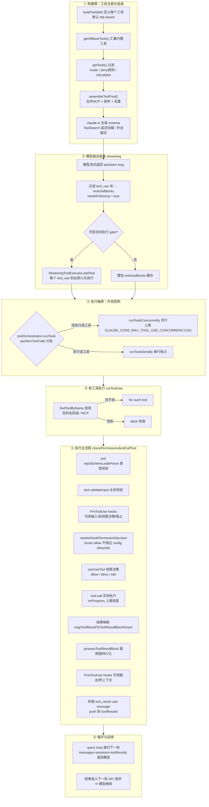

# Claude Code 工具调用完整生命周期

> 本文从 `src` 源码层面梳理一个工具调用从「模型产生 intent」到「结果回填上下文」的完整链路。
> 覆盖：工具的定义与注册 → 模型输出收集 → 执行编排（并发控制）→ 单工具执行
> （输入校验 → PreToolUse hooks → 权限决策 → 实际调用 → 结果映射/持久化 →
> PostToolUse hooks）→ 结果回写 → 下一轮循环，以及贯穿全程的错误处理。

## 一、生命周期全景图



## 二、① 构建期：工具如何被定义与注册

### 2.1 工具定义接口 —— `src/Tool.ts`

每个工具是一个满足 `Tool` 接口的对象。关键契约字段：

| 字段 | 作用 |
|------|------|
| `name` / `aliases` | 主名与历史别名（命中别名仅回退用，不向 API 暴露） |
| `call()` | **真正的执行入口**，返回 `Promise<ToolResult>` |
| `inputSchema` | zod 模式，`safeParse` 做类型校验 |
| `validateInput()` | 工具特有的业务校验（在权限检查前） |
| `checkPermissions()` | 工具特有的权限判定（给权限系统补充规则） |
| `isReadOnly()` / `isConcurrencySafe()` | 决定并发编排与只读分类 |
| `isDestructive()` | 标记不可逆操作（删除/覆盖/发送） |
| `interruptBehavior()` | `'cancel'` / `'block'`，决定执行中收到新消息时中止还是等待 |
| `requiresUserInteraction()` | 需要用户交互才能执行 |
| `isSearchOrReadCommand()` | UI 折叠展示用 |
| `mapToolResultToToolResultBlockParam()` | 把输出映射为 API 的 `tool_result` 块 |
| `maxResultSizeChars` | 结果持久化阈值（超出写盘，模型收预览） |
| `renderToolUseMessage`/`renderToolResultMessage` 等 | Ink UI 渲染 |
| `shouldDefer` / `alwaysLoad` | ToolSearch 延迟加载与常驻 |
| `backfillObservableInput()` | 在观察者看到前补齐派生字段（不改 API 原始输入） |

工具通过 `buildTool(def)` 构建。`Tool.ts` 的 `TOOL_DEFAULTS` 提供 **fail-closed 默认值**：
- `isEnabled = () => true`
- `isConcurrencySafe = false`（默认假定不安全，串行）
- `isReadOnly = false`（默认假定会写）
- `isDestructive = false`
- `checkPermissions = { behavior: 'allow' }`（默认把权限交给通用权限系统）
- `toAutoClassifierInput = ''`（默认不参与安全分类器；安全相关工具必须覆盖）

### 2.2 工具汇总与过滤 —— `src/tools.ts`

- `getAllBaseTools()`（`tools.ts:193`）：静态汇入全部内置工具，按 feature 开关 / 环境变量条件引入（REPLTool 仅 ant、LSPTool 需 `ENABLE_LSP_TOOL`、PowerShell 按 shell 工具开关）。
- `getTools(permissionContext)`（`tools.ts:271`）：**应用层过滤**——
  1. `CLAUDE_CODE_SIMPLE` 模式只留 Bash/Read/Edit（+REPL 包裹）
  2. 剔除需条件注入的特殊工具（`ListMcpResourcesTool` 等）
  3. `filterToolsByDenyRules`：有整条 blanket deny 规则的工具 **在模型看到前就被移除**（`tools.ts:262`）
  4. `isEnabled()` 逐个确认
- `assembleToolPool(permissionContext, mcpTools)`（`tools.ts:345`）：内置 + MCP 合并，各 partition 按名称排序（保证 prompt 缓存稳定），`uniqBy('name')` 去重（内置优先）。

> 之后由 `claude.ts`/系统提示构建阶段，把 Tool pool 转成 API 可用的 tool 定义：
> - ToolSearch 开启时，`shouldDefer` 的工具 schema **不随首轮发送**，需模型先 `ToolSearch` 拉取；
> - `alwaysLoad` 工具总是随首轮出现。

## 三、② 模型输出收集 —— `src/query.ts`

`query()` 是主循环（query loop）。每轮向 API 发请求，消费流式响应：

- `query.ts:557` 每轮声明 `toolUseBlocks`；
- streaming 循环中（`query.ts:826-844`），每收到一个 **assistant message**，就过滤出其中 `type === 'tool_use'` 的块：
  ```ts
  const msgToolUseBlocks = message.message.content.filter(
    content => content.type === 'tool_use',
  )
  toolUseBlocks.push(...msgToolUseBlocks)
  needsFollowUp = true
  ```
- 注释明确指出 `stop_reason === 'tool_use'` 不可靠，**以是否收集到 tool_use 块作为循环继续的唯一信号**（`needsFollowUp`）。

**两种执行模式的岔路口**（gate `config.gates.streamingToolExecution`）：

- **流式执行（默认/现代）**：`StreamingToolExecutor`。每个 `tool_use` 块到达即 `addTool()` 入队，**边接收边执行**（`query.ts:838-844`）。
- **批量执行（传统）**：全部块收集完成后，一次性交给 `runTools()`。

## 四、③ 执行编排：并发控制

### 4.1 批量模式 `runTools` —— `services/tools/toolOrchestration.ts`

`partitionToolCalls`（`toolOrchestration.ts`）把工具调用分成若干 batch：
- 通过 `tool.isConcurrencySafe(parsedInput)` 判定；
- **连续的只读/并发安全工具**合并为一个并发 batch；
- 遇到非并发工具则**自分成单个 batch**（独占）。

`runTools` 遍历 batch：
- 并发安全 batch → `runToolsConcurrently`（`all(...)` 并发，上限 `CLAUDE_CODE_MAX_TOOL_USE_CONCURRENCY`，默认 10）；contextModifier 被收集后在 batch 结束时批量应用；
- 非并发 batch → `runToolsSerially`（逐个串行，contextModifier 即时应用）。

每个工具都通过 `runToolUse` 执行，进度信息实时 yield。

### 4.2 流式模式 `StreamingToolExecutor` —— `services/tools/StreamingToolExecutor.ts`

维护 `TrackedTool` 队列与状态机（`queued/executing/completed/yielded`）：

- **并发规则**（`canExecuteTool`，`StreamingToolExecutor.ts:129`）：当前无执行中工具，或新工具并发安全且所有执行中工具都并发安全，才启动；否则非并发工具阻塞后续。
- **sibling 级联取消**：Bash 工具报错 → `siblingAbortController.abort('sibling_error')`，杀掉并行兄弟子进程（`StreamingToolExecutor.ts:355-364`）。
- **interrupt 语义**（`getToolInterruptBehavior`）：用户新消息打断时，`interruptBehavior()==='cancel'` 的工具被取消，`'block'` 的继续（`StreamingToolExecutor.ts:210-231`）。
- 每个工具持有**子级 AbortController**（`toolAbortController`，`StreamingToolExecutor.ts:301-318`）：权限对话框拒绝时中止并向上冒泡结束本轮（`cancelAndAbort`）。
- `getRemainingResults` / `getCompletedResults`（`StreamingToolExecutor.ts:412,453`）在流结束后消费结果，进度消息立即 yield；`getCompletedResults` 中非并发工具会 `break` 维持提交顺序。

## 五、④ 单工具执行入口 `runToolUse` —— `services/tools/toolExecution.ts`

`runToolUse`（`toolExecution.ts:337`）是每个工具的入口生成器：

1. **查找工具**：先在前端可见的 `options.tools` 里找；找不到再回退到 `getAllBaseTools()`，**仅在命中别名（弃用名）时接受**（`toolExecution.ts:345-356`）。
2. **未知工具**：立即产出 `<tool_use_error>No such tool available` user message 并结束。
3. **abort 检查**：信号已中止 → 产出取消 tool_result，不执行。
4. 委托 `streamedCheckPermissionsAndCallTool`（把进度事件与结果统一成一个 async iterable，`toolExecution.ts:492`）→ `checkPermissionsAndCallTool`（`toolExecution.ts:599`，核心）。

## 六、⑤ 执行主流程 `checkPermissionsAndCallTool`

这是生命周期的心脏，顺序执行以下步骤：

### 6.1 输入校验（类型 + 业务）
- **zod 类型校验**：`tool.inputSchema.safeParse(input)`。失败 → 构造 `InputValidationError` tool_result。对延迟工具附上「schema 未发送」hint（`buildSchemaNotSentHint`），提示模型先 ToolSearch 加载。
- **业务校验**：`tool.validateInput()`。失败 → `tool_use_error`。
- Bash 工具在这里会**抢先启动分类器检查**（`startSpeculativeClassifierCheck`），与 hooks/权限对话框并行，减少等待。

### 6.2 防御性输入处理
- 剥离模型提供的内部字段 `_simulatedSedEdit`——该字段只允许权限系统注入。
- `backfillObservableInput`：对可观察输入做浅拷贝补齐派生字段，**不污染传给 `call()` 的原始输入**，保持 transcript/VCR hash 稳定。

### 6.3 PreToolUse hooks —— `services/tools/toolHooks.ts`
`runPreToolUseHooks`（`toolHooks.ts:435`）逐个产出结果，共 5 种可作用：
- **`updatedInput`**：hooks 直接改写输入（passthrough，不阻断权限流）；
- **`permissionBehavior`**：`allow/deny/ask` → 生成 `hookPermissionResult`，作为权限决策的输入；
- **`preventContinuation`**：hook 阻止后续继续（产出 stop 消息）；
- **`additionalContext`**：注入附加上下文消息；
- **`blockingError`**：hook 报错 → 视为 deny。
- 到期 abort → `hook_cancelled` + stop。

### 6.4 权限决策 —— `resolveHookPermissionDecision` + `canUseTool`

**a) `resolveHookPermissionDecision`（`toolHooks.ts:332`）** 维护关键不变量：**hook 的 allow 不绕过 settings.json 的 deny/ask 规则**，`checkRuleBasedPermissions` 仍会执行。分支：
- hook `allow` + 无交互要求 → 仍查 rule，rule 为 null 才放行，deny 覆盖，ask 再走 canUseTool；
- hook `deny` → 直接拒绝；
- 无 hook 决策 / `ask` → 走 `canUseTool` 通用权限流。

**b) `canUseTool`（`hooks/useCanUseTool.tsx`）**：
1. 调 `hasPermissionsToUseTool`（`utils/permissions/permissions.ts`）做**规则+分类器判定**，核心产出 `PermissionDecision`（behavior + decisionReason + updatedInput + suggestions）；
2. `allow` → 记决策（分类器来源记录批准）；
3. `deny` → 记拒绝，auto-mode 分类器拒绝则记 auto-mode 拒绝 + 通知；
4. **`ask` → 按环境分派交互处理器**：
   - coordinator worker（`awaitAutomatedChecksBeforeDialog`）→ `handleCoordinatorPermission` 先等自动化判定；
   - swarm worker → `handleSwarmWorkerPermission`；
   - Bash 且有 `pendingClassifierCheck` → 与**抢先分类器**做 2 秒竞速（`Promise.race`），命中高置信匹配则免弹框；
   - 主交互线程 → `handleInteractivePermission` 弹权限对话框（或 bridge/channel 回调）。

**权限决策后的走向**：
- `behavior !== 'allow'` → 构造 `tool_result` 错误 + 拒绝附带的图片块/acceptFeedback；auto-mode 分类器拒绝可触发 PermissionDenied hooks 让模型重试。
- `allow` → 用 `updatedInput`（权限/钩子可能改过输入）继续。

### 6.5 实际执行 `tool.call()`（`toolExecution.ts:1207`）
- 传入 `{ ...toolUseContext, toolUseId, userModified }`、`canUseTool`、`assistantMessage`、`onProgress`；
- 结果 `ToolResult`：`data`（输出）、`newMessages`（新消息）、`contextModifier`（改上下文）、`mcpMeta`；
- `onProgress` 上报的进度 → 产出 `ProgressMessage`，**立即 yield** 到 UI/流；
- 执行时长记入 `addToToolDuration` 并打遥测。

### 6.6 结果映射与持久化
- `tool.mapToolResultToToolResultBlockParam(data, toolUseID)` → API `ToolResultBlockParam`。
- `processToolResultBlock`（`utils/toolResultStorage.ts`）：结果超过 `maxResultSizeChars` 阈值 → **写入磁盘 `tool-results/`**，模型只收到带 `<persisted-output>` 包裹的预览与文件路径。`getPersistenceThreshold` 支持 GrowthBook 按工具覆盖阈值；`Infinity` 表示强制不持久化（如 Read）。

### 6.7 PostToolUse hooks
`runPostToolUseHooks`（`toolHooks.ts`）：
- **MCP 工具**：先 `addToolResult`，hook 可通过 `updatedMCPToolOutput` **改写 MCP 输出**；
- 非 MCP 工具：先 `addToolResult`，hook 消息随后追加；
- 同样支持附加上下文、阻塞、`hook_cancelled`。

### 6.8 结果封装与回写
`addToolResult` 把结果封装成 `createUserMessage({ content: [tool_result...] })`，连同 `acceptFeedback`、允许附带的图片块、`contextModifier` 一起 push 进 `resultingMessages`。随后被 yield 出去（由 query loop 收下）。

> 注意：`tool_result` 的 `content` 通过 `mapToolResultToToolResultBlockParam` 是**写给模型看**的序列化；`renderToolResultMessage` / `extractSearchText` 是写给 UI/搜索的，二者分离。

## 七、⑥ 循环关闭与回填

`query.ts` 消费 `runTools`/`getRemainingResults` 的更新：
- `update.message` → `toolResults.push(...normalizeMessagesForAPI([update.message]).filter(user))`；
- `update.newContext` → 更新 `updatedToolUseContext`。

一轮工具全部执行完毕后，`query loop` 依据 `needsFollowUp`（存在 tool_use 块）**递归进入下一轮**，把：
```
messagesForQuery + assistantMessages + toolResults
```
一并发回 API。`tool_result` 块回到模型，模型继续决策 → 循环往复，直到无 tool_use 返回。

## 八、错误与中断处理

`checkPermissionsAndCallTool` 的 catch：
- 记时、结束 span；
- `McpAuthError` → 把对应 MCP 客户端状态改为 `needs-auth`（`/mcp` 显示需重新授权）；
- `AbortError` → 用户打断，`isInterrupt=true`；
- 其余错误 → 分类错误（生产构建下构造函数名会被混淆，故提取稳定标识分类）记录遥测；
- 运行 **PostToolUseFailure hooks**，最后返回包装的错误 tool_result。

流式模式下的中断（`StreamingToolExecutor.ts`）：
- `user_interrupted`（ESC 拒）→ `REJECT_MESSAGE`（UI 显示 "User rejected"）；
- `sibling_error`（并行 Bash 报错）→ 生成"并行工具报错被取消"块；
- `streaming_fallback`（流模式回退）→ 丢弃未完成工具。

## 九、特殊工具路径（对比）

- **MCP 工具**：`findMcpServerConnection` 按 `mcp__server__tool` 前缀解析传输类型与 base URL；执行结果经 hooks 后可改写；认证错误单独处理。
- **子代理工具**（AgentTool 等）：`toolUseContext.agentId` 存在时，`toolUseResult` 默认不保留（`preserveToolUseResults`），mcpMeta 透传受控。
- **REPL 工具**：`resolveHookPermissionDecision` 与 REPLTool 内层调用共享同一套权限语义。

## 十、关键源码文件索引

| 文件 | 职责 |
|------|------|
| `src/Tool.ts` | Tool 接口 / `buildTool` / 默认值 / ToolUseContext |
| `src/tools.ts` | `getAllBaseTools` / `getTools` / `assembleToolPool` |
| `src/query.ts` | query loop：收集 tool_use、并发入口、循环回填 |
| `src/services/tools/toolOrchestration.ts` | 批量编排（串行/并发分批） |
| `src/services/tools/StreamingToolExecutor.ts` | 流式执行器（边收边执行/级联取消） |
| `src/services/tools/toolExecution.ts` | 单工具执行主流程（校验/hooks/权限/call/结果） |
| `src/services/tools/toolHooks.ts` | Pre/PostToolUse hooks 封装与权限决议 |
| `src/hooks/useCanUseTool.tsx` | 权限决策分派（ask 交互/coordinator/swarm/分类器） |
| `src/utils/permissions/permissions.ts` | 规则匹配 + 权限判定核心 |
| `src/utils/toolResultStorage.ts` | 大结果持久化与阈值 |
